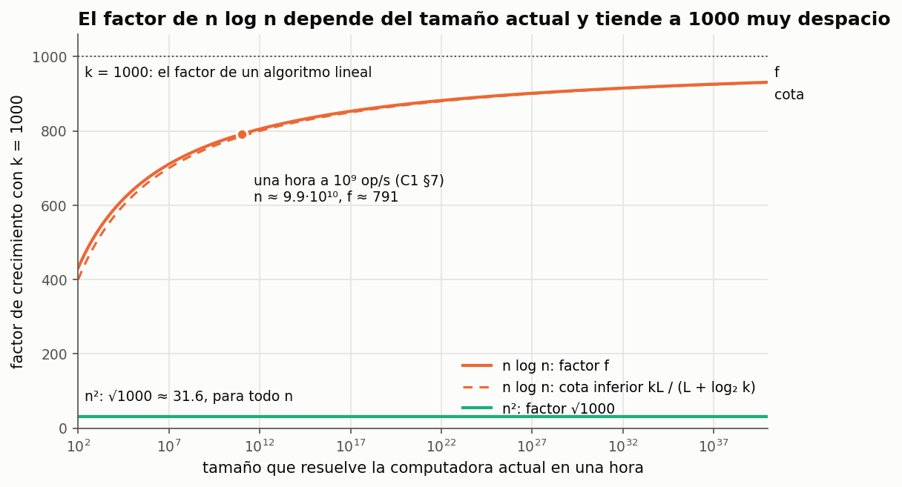
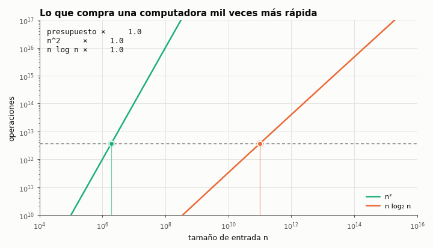

# Ejercicio 1. Una computadora mil veces más rápida

> **Enunciado.** ★ Una computadora mil veces más rápida. ¿Cuánto crece el tamaño de entrada que se resuelve en una hora con un algoritmo $\Theta(n^2)$? ¿Y con uno $\Theta(n \log n)$? Estima los dos factores. (C1)

## Respuesta

- Con $\Theta(n^2)$, la entrada crece un factor $\sqrt{1000} \approx 31.6$. No depende de la constante, de la velocidad original ni del tamaño de partida.
- Con $\Theta(n \log n)$, crece un factor $f = 1000 \cdot \log n / \log n'$, algo menor que $1000$. Aquí $n$ y $n'$ son los tamaños que resuelven la computadora vieja y la nueva. Con los números de C1, §7 ($10^9$ operaciones por segundo), $785.6 < f < 791.5$ por una cuenta a mano, y $f \approx 791$. El factor depende del tamaño de partida y tiende a $1000$ muy despacio.

### Planteo

Un algoritmo cuesta $T(n)$ operaciones en el peor caso (C1). En una hora, la computadora actual tiene un presupuesto de $B$ operaciones y la nueva de $kB$, con $k = 1000$. El mayor tamaño resoluble y el factor pedido son

$$
N(B) = \max\{\, n \ge 1 : T(n) \le B \,\}, \qquad F(B) = \frac{N(kB)}{N(B)} .
$$

Si $T(n) \to \infty$, $N(B)$ está bien definido. Además no decrece con $B$, tiende a infinito con $B$, y por ser el máximo cumple

$$
T(N) \le B < T(N+1), \qquad N = N(B). \tag{1}
$$

$\Theta$ sola no basta para dar un número. Si $c_1 n^2 \le T(n) \le c_2 n^2$, las desigualdades (1) solo encierran el factor entre $\sqrt{k c_1/c_2}$ y $\sqrt{k c_2/c_1}$, y hay costos $\Theta(n^2)$ cuyo factor no converge. Por ejemplo, el costo que vale $n^2$ cuando $n$ tiene una cantidad impar de cifras y $2n^2$ cuando tiene una cantidad par tiene factor que alterna para siempre entre $\sqrt{1000} \approx 31.6$ y $\sqrt{500} \approx 22.4$. 

### $\Theta(n^2)$

Supongamos $T(n) \sim c\, n^2$. Dividiendo (1) por $c N^2$,

$$
\frac{T(N)}{c N^2} \le \frac{B}{c N^2} < \frac{T(N+1)}{c(N+1)^2}\left(\frac{N+1}{N}\right)^2 .
$$

Cuando $B$ crece, $N$ también, y los dos extremos tienden a $1$. Entonces $B / (cN^2) \to 1$: el tamaño resoluble se comporta como $N(B) \sim \sqrt{B/c}$. Con el presupuesto $kB$ pasa lo mismo, $N(kB) \sim \sqrt{kB/c}$, y al dividir se cancelan $c$ y $B$:

$$
F(B) \to \sqrt{k} = \sqrt{1000} \approx 31.62 .
$$

En la cuenta no intervinieron ni la constante, ni la velocidad de la computadora, ni el tamaño de partida, y por eso el factor no depende de ellos.

### $\Theta(n \log n)$

Supongamos ahora $T(n) \sim c\, n \log n$. Como $(N+1)\log(N+1) / (N \log N) \to 1$, el mismo encierre de (1) da $B \sim c\, N \log N$ y $kB \sim c\, N' \log N'$, con $N = N(B)$ y $N' = N(kB)$. Sea $r = N'/N$, que es al menos $1$ porque $N$ no decrece con el presupuesto. Dividiendo las dos relaciones,

$$
r\left(1 + \frac{\log r}{\log N}\right) \to k .
$$

El paréntesis es al menos $1$, así que $r$ no puede pasar de $k$ más que en una cantidad que tiende a $0$. Entonces $r$ está acotado, $\log r / \log N \to 0$, y $r \to k$: el factor tiende a $1000$. Pero el término $\log r / \log N$ se achica muy despacio, así que el límite dice poco sobre un tamaño concreto. Para eso hay que calcular el factor.

Tomamos el costo exacto $T(x) = c\, x \log_2 x$ con $x$ real. Cambiar la base del logaritmo solo cambia $c$. Sean $x$ e $y$ los tamaños que se resuelven con $B$ y con $kB$, $f = y/x$ y $L = \log_2 x$. De $c\, y \log_2 y = k\, c\, x \log_2 x$ sale

$$
f\,(L + \log_2 f) = kL. \tag{2}
$$

Despejando, $f = g(f)$ con $g(t) = kL / (L + \log_2 t)$. De (2) se sacan tres cosas, para $L \ge 1$ y $k \ge 2$.

**El factor existe, es único y es menor que $k$.** La función $\varphi(t) = t\,(L + \log_2 t)$ es continua y estrictamente creciente en $[1, \infty)$. Además $\varphi(1) = L < kL$ y $\varphi(k) = k(L + \log_2 k) > kL$. Por el valor intermedio, $\varphi(t) = kL$ tiene una raíz en $(1, k)$, y por la monotonía es la única.

**Una cota inferior.** Como $f < k$, se tiene $\log_2 f < \log_2 k$, y entonces

$$
f = g(f) > g(k) = \frac{kL}{L + \log_2 k} .
$$

**Una cota superior que se calcula a mano.** La función $g$ es decreciente y $f$ es su punto fijo. Sea $f_1 = g(k)$, la cota inferior que acabamos de obtener, y sea $f_2 = g(f_1)$. Como $f_1 < f$ y $g$ es decreciente, $f_2 = g(f_1) > g(f) = f$. Entonces

$$
f_1 < f < f_2 .
$$

Como $L + \log_2 f = \log_2 y$, la ecuación (2) también se lee

$$
f = k \cdot \frac{\log_2 x}{\log_2 y} .
$$

El factor es $k$ por el cociente de las longitudes en bits del tamaño viejo y el nuevo. La pérdida respecto de $k$, $1 - f/k = \log_2 f / \log_2 y$, es la parte de los bits nuevos que se gastó en crecer. Por eso $f$ se acerca a $1000$ tan despacio.

### El número

Con $c = 1$ y $B = 3.6 \cdot 10^{12}$ (una hora a $10^9$ operaciones por segundo, como en C1, §7), la ecuación $x \log_2 x = B$ da $x \approx 9.86 \cdot 10^{10}$ y $L \approx 36.52$. A mano:

$$
f_1 = \frac{36\,520}{36.52 + \log_2 1000} = \frac{36\,520}{46.49} \approx 785.6,
\qquad
f_2 = \frac{36\,520}{36.52 + \log_2 785.6} = \frac{36\,520}{46.14} \approx 791.5 .
$$

El valor exacto de (2) es $f \approx 791.37$, y la tabla de C1, §7 da $7.80 \cdot 10^{13} / 9.86 \cdot 10^{10} \approx 791$.

---

## Extras

### 1. Verificación con el programa de C1, §7

La búsqueda binaria de C1, §7, sin cambios, calcula $N(B)$ con enteros, sin el modelo continuo ni ninguna aproximación de la respuesta. Sirve de oráculo:

<!-- codigo: extra_01/calculos.py mayor_n, factor -->
```python
def mayor_n(costo, presupuesto):
    """El mayor n con costo(n) <= presupuesto, por búsqueda binaria.
    Supone costo(1) <= presupuesto y costo no decreciente."""
    alto = 2
    while costo(alto) <= presupuesto:
        alto *= 2
    bajo = alto // 2
    while bajo + 1 < alto:
        medio = (bajo + alto) // 2
        if costo(medio) <= presupuesto:
            bajo = medio
        else:
            alto = medio
    return bajo

def factor(costo, presupuesto, k=K):
    """N(k·B) / N(B): cuánto crece la entrada resoluble si el presupuesto crece k veces."""
    return mayor_n(costo, k * presupuesto) / mayor_n(costo, presupuesto)
```
<!-- /codigo -->

<!-- salida: extra_01/calculos.py verificacion -->
| k | n²: medido | √k | n log n: medido | n log n: f | f₁ – f₂ (a mano) |
|---:|---:|---:|---:|---:|---:|
| 10 | 3.16 | 3.16 | 9.2 | 9.2 | 9.2 – 9.2 |
| 100 | 10.00 | 10.00 | 85.1 | 85.1 | 84.6 – 85.1 |
| 1,000 | 31.62 | 31.62 | 791.4 | 791.4 | 785.6 – 791.5 |
| 1,000,000 | 1,000.00 | 1,000.00 | 654,026.4 | 654,026.4 | 646,929.3 – 654,210.8 |
<!-- /salida -->

En las cuatro aceleraciones, el factor medido de $n^2$ es $\sqrt{k}$, el de $n \log n$ coincide con la solución de (2), y esa solución cae entre las dos cotas $f_1$ y $f_2$ de la cuenta a mano. Con $k = 10^6$ se ve lo engañoso de "$n \log n$ es casi lineal": el factor es $654\,000$ y no $10^6$, porque el tamaño nuevo tiene $55.8$ bits contra $36.5$ del viejo.

### 2. El factor depende del tamaño de partida

El factor de $n^2$ es el mismo para cualquier $n$. El de $n \log n$ no: depende de $L = \log_2 n$.

<!-- salida: extra_01/figuras.py factor_tamano -->

<!-- /salida -->

*Figura 1. El factor de $n \log n$ según el tamaño que ya resolvía la computadora vieja, y la cota inferior $f_1$, en línea discontinua, que se le pega a medida que $n$ crece. El factor de $n^2$ es la recta horizontal de abajo.*

<!-- salida: extra_01/calculos.py por_tamano -->
| n actual | L = log₂ n | factor f | cota inferior f₁ | pérdida 1 − f/k |
|---:|---:|---:|---:|---:|
| 10³ | 10.0 | 524.5 | 500.0 | 47.6% |
| 10⁶ | 19.9 | 679.3 | 666.7 | 32.1% |
| 10⁹ | 29.9 | 757.6 | 750.0 | 24.2% |
| 10¹² | 39.9 | 805.1 | 800.0 | 19.5% |
| 10¹⁸ | 59.8 | 859.8 | 857.1 | 14.0% |
| 10³⁰ | 99.7 | 910.2 | 909.1 | 9.0% |
| 10¹⁰⁰ | 332.2 | 971.0 | 970.9 | 2.9% |
<!-- /salida -->

Con $n = 10^6$ el factor es $679$, y con $n = 10^{100}$, más que el número de átomos del universo, todavía pierde un $3\,\%$ respecto de $1000$. La cota inferior $f_1$ es una buena estimación de un solo paso: su error es de casi $5\,\%$ con $n = 10^3$ y baja de $1\,\%$ desde $n = 10^{12}$.

### 3. Lo que compra la aceleración

<!-- salida: extra_01/figuras.py animacion -->

<!-- /salida -->

*Figura 2. El presupuesto, la línea discontinua, sube de una hora a mil horas de la computadora vieja. Los círculos vacíos marcan dónde estaba cada algoritmo, y los llenos, hasta dónde llega. En ejes log-log, $n^2$ es una recta de pendiente 2: para la misma subida del presupuesto avanza la mitad en $n$, y por eso su factor es la raíz. $n \log n$ tiene pendiente apenas mayor que 1 y avanza casi lo mismo que sube el presupuesto.*

### Cómo reproducir

El código y las figuras de los extras están en `extra_01/`. Desde la carpeta del tema:

```
pip install -r requirements.txt
python -m comun.regenerar ejercicio-01.md   # recalcula tablas, figuras y código de este archivo
```
