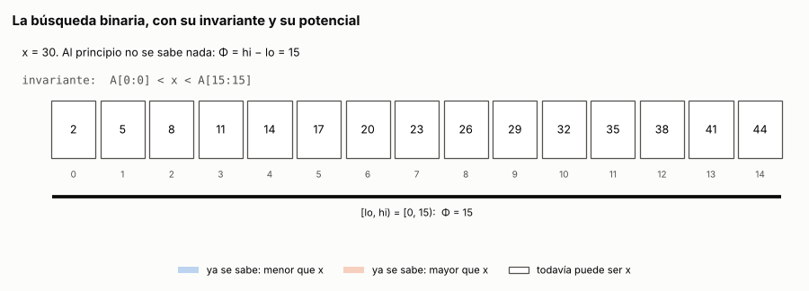

# Ejercicio 2. Invariante, potencial y cota de la búsqueda binaria

> **Enunciado.** ★ Da el invariante y el potencial de la búsqueda binaria, y la cota de información que la hace óptima. (C3, C5)

## Respuesta

- **Invariante:** al principio de cada vuelta, todo lo que está a la izquierda de `lo` es menor que $x$ y todo lo que está desde `hi` es mayor. Solo $A[lo:hi]$ puede contener a $x$.
- **Potencial:** $\Phi = hi - lo$. Baja en cada vuelta y, de hecho, se reduce al menos a la mitad. Por eso la búsqueda hace a lo sumo $\lceil \log_2(n+1) \rceil$ comparaciones, y ese número se alcanza.
- **Cota de información:** un arreglo de $n$ elementos tiene $n+1$ huecos, y un algoritmo correcto tiene que llevar cada hueco a una hoja distinta de su árbol de decisión. Así que todo algoritmo de comparaciones hace al menos $\lceil \log_2(n+1) \rceil$ comparaciones en el peor caso. Coincide exactamente con el costo de la búsqueda binaria, que es óptima.

### El problema y el modelo

**Entrada:** un arreglo $A[0:n]$ ordenado de forma no decreciente, que es la precondición, y un valor $x$.

**Salida:** `("está", m)` con $A[m] = x$, o bien `("hueco", h)` si $x$ no está. En ese caso $A[i] < x$ para $i < h$ y $A[i] > x$ para $i \ge h$: $x$ cae en el hueco $h$, uno de los $n+1$ huecos de C5, §3.

**Modelo:** comparaciones (C5, §1). El algoritmo solo accede a los datos comparando $x$ con un elemento, la respuesta es $<$, $=$ o $>$, y el costo es el número de comparaciones.

### El algoritmo

Es el de C5, §3. Devuelve el hueco y no solo "no está", porque el hueco es lo que usa la cota mínima.

<!-- codigo: extra_02/busqueda.py busqueda_binaria -->
```python
def busqueda_binaria(A, x, comparar=comparar):
    """Devuelve ("está", m) con A[m] = x, o ("hueco", h) si x no está y cae
    en el hueco h. Es el código de C5, §3."""
    lo, hi = 0, len(A)
    while lo < hi:
        m = (lo + hi) // 2
        r = comparar(x, A[m])
        if r == 0:
            return ("está", m)
        if r < 0:
            hi = m
        else:
            lo = m + 1
    return ("hueco", lo)
```
<!-- /codigo -->

### Correctitud parcial: el invariante

Al principio de cada vuelta del ciclo,

$$
0 \le lo \le hi \le n, \qquad A[i] < x \ \text{ para } i < lo, \qquad A[i] > x \ \text{ para } i \ge hi. \tag{1}
$$

**Inicialización.** Con $lo = 0$ y $hi = n$, los dos rangos de índices son vacíos y $0 \le 0 \le n$.

**Mantenimiento.** Si se entra al ciclo, $lo < hi$, y entonces $m = \lfloor (lo + hi)/2 \rfloor$ cumple $lo \le m < hi$. Hay un caso por rama:

- Si $x = A[m]$, devuelve `("está", m)`, que es correcto, y no hay otra vuelta.
- Si $x < A[m]$, hace $hi \leftarrow m$. Para $i \ge m$, el orden da $A[i] \ge A[m] > x$. La parte izquierda no cambia, y $lo \le m$.
- Si $x > A[m]$, hace $lo \leftarrow m + 1$. Para $i \le m$, el orden da $A[i] \le A[m] < x$. Además $m + 1 \le hi$.

**Conclusión.** El ciclo sale con $lo \ge hi$, y por (1) $lo \le hi$, así que $lo = hi = h$. Entonces (1) dice que $A[i] < x$ para $i < h$ y $A[i] > x$ para $i \ge h$: ningún elemento es igual a $x$, y $x$ cae en el hueco $h$. Es exactamente lo que devuelve.

El invariante de C3, §1, "si $x$ está, está en $A[lo:hi]$", también se mantiene y alcanza para concluir que $x$ no está. Pero no dice en qué hueco cae. Para eso hacen falta las dos mitades de (1), que dicen además de qué lado quedó cada elemento descartado. Es la lección de C3, §4: el invariante tiene que cargar todo lo que la conclusión va a necesitar.

### Terminación: el potencial

Sea $\Phi = hi - lo$. Es un entero, y por (1) es no negativo. En una vuelta que no devuelve, $\Phi \ge 1$, y como $m = lo + \lfloor \Phi/2 \rfloor$:

- Si $hi \leftarrow m$, el potencial nuevo es $\Phi' = m - lo = \lfloor \Phi/2 \rfloor$.
- Si $lo \leftarrow m + 1$, el potencial nuevo es $\Phi' = hi - m - 1 = \Phi - \lfloor \Phi/2 \rfloor - 1 = \lceil \Phi/2 \rceil - 1$.

En los dos casos $\Phi' \le \lfloor \Phi/2 \rfloor < \Phi$. Un entero no negativo no puede bajar para siempre, así que el ciclo termina.

El paso delicado es el $+1$ de `lo = m + 1`. Sin él, la segunda rama daría $\Phi' = \lceil \Phi/2 \rceil$, que vale $1$ cuando $\Phi = 1$: el potencial dejaría de bajar (extra 3).

### Costo

Como $\Phi' \le \lfloor \Phi/2 \rfloor$ y $\lfloor \lfloor a/2^j \rfloor / 2 \rfloor = \lfloor a/2^{j+1} \rfloor$, después de $j$ vueltas $\Phi \le \lfloor n/2^j \rfloor$. Con $n \ge 1$ y $j = \lfloor \log_2 n \rfloor + 1$ se tiene $2^j > n$, así que $\Phi = 0$ y el ciclo ya no sigue. Cada vuelta hace una comparación, así que

$$
C(n) \le \lfloor \log_2 n \rfloor + 1 = \lceil \log_2(n+1) \rceil . \tag{2}
$$

La igualdad entre las dos expresiones sale de que, si $2^k \le n < 2^{k+1}$, las dos valen $k + 1$. Cada vuelta hace trabajo constante, así que el tiempo es $O(\log n)$, y la memoria extra es $O(1)$.

La cota (2) se alcanza. Si $x$ es menor que todos los elementos, siempre se toma la rama $hi \leftarrow m$, el potencial pasa exactamente de $\Phi$ a $\lfloor \Phi/2 \rfloor$, y llevar $n$ a $0$ dividiendo por dos toma exactamente $\lfloor \log_2 n \rfloor + 1$ pasos. El peor caso es entonces $\lceil \log_2(n+1) \rceil$ exacto.

### Cota mínima: el argumento de información

Fijemos $n$ y un algoritmo cualquiera del modelo. Sus ejecuciones forman un árbol de decisión con tres ramas por nodo, y su peor caso es la altura del árbol (C5, §2).

1. Si $x$ no está en $A$, ninguna comparación responde $=$, así que la ejecución solo baja por ramas $<$ y $>$.
2. Dos valores de $x$ que caen en huecos distintos tienen que terminar en hojas distintas (C5, §3, lema 4). Si terminaran en la misma, el algoritmo no comparó $x$ con ningún elemento $a_i$ que esté entre los dos huecos, porque esa comparación les habría dado respuestas distintas. Entonces $x = a_i$ recibe las mismas respuestas que los dos, llega a la misma hoja, y el algoritmo dice que $a_i$ no está.
3. Entonces los $n + 1$ huecos llegan a $n + 1$ hojas distintas, todas dentro del árbol binario que forman las ramas $<$ y $>$. Un árbol binario de altura $h$ tiene a lo sumo $2^h$ hojas (C5, §3, lema 1), así que $2^h \ge n + 1$. Como $h$ es entero,

$$
h \ge \lceil \log_2(n+1) \rceil . \tag{3}
$$

Contar todas las salidas posibles, las $n$ posiciones más los $n+1$ huecos, daría solo $\log_3(2n+1)$, porque el árbol tiene tres ramas. Por eso el argumento se restringe a los huecos, donde el árbol es binario (C5, §3).

### Conclusión

El peor caso de la búsqueda binaria, (2), y la cota mínima, (3), coinciden exactamente para todo $n$, no solo asintóticamente. La búsqueda binaria es óptima en el modelo de comparaciones. Como toda cota, (3) vale en su modelo: con claves enteras acotadas, una tabla indexada por el valor responde sin comparar, como el ordenamiento por conteo de C5, §9.

---

## Extras

### 1. El invariante y el potencial, dibujados

<!-- salida: extra_02/figuras.py animacion -->

<!-- /salida -->

*Figura 1. La búsqueda de $x = 30$ en quince elementos. Cada comparación pinta de azul o de naranja una mitad del intervalo: es el invariante (1) creciendo desde los bordes. La barra negra es $[lo, hi)$, y su largo es el potencial $\Phi$: $15, 7, 3, 1, 0$, la mitad o menos cada vez. Al final $lo = hi = 10$, y el triángulo marca el hueco donde cae $x$. Son cuatro comparaciones, que es $\lceil \log_2 16 \rceil$, el peor caso para $n = 15$.*

### 2. Comprobación exhaustiva

Con valores distintos, la búsqueda solo ve dónde cae $x$ respecto de los elementos: en una de las $n$ posiciones o en uno de los $n + 1$ huecos. Dos entradas con la misma situación reciben las mismas respuestas y siguen el mismo camino. Por eso probar esas $2n + 1$ situaciones es probar todas las entradas de largo $n$ con valores distintos.

La versión vigilada comprueba al principio de cada vuelta el invariante (1) y la cota del potencial $\Phi_j \le \lfloor n / 2^j \rfloor$, y cuenta las comparaciones:

<!-- codigo: extra_02/busqueda.py busqueda_vigilada -->
```python
def busqueda_vigilada(A, x):
    """La misma búsqueda, con el invariante y la cota del potencial comprobados
    al principio de cada vuelta. Devuelve (resultado, comparaciones)."""
    n = len(A)
    lo, hi, vueltas = 0, n, 0
    while True:
        assert 0 <= lo <= hi <= n
        assert all(A[i] < x for i in range(lo)), "invariante: A[0:lo] < x"
        assert all(A[i] > x for i in range(hi, n)), "invariante: A[hi:n] > x"
        assert hi - lo <= n >> vueltas, "potencial: Φ_j ≤ ⌊n / 2^j⌋"
        if lo >= hi:
            return ("hueco", lo), vueltas
        m = (lo + hi) // 2
        vueltas += 1
        r = comparar(x, A[m])
        if r == 0:
            return ("está", m), vueltas
        if r < 0:
            hi = m
        else:
            lo = m + 1
```
<!-- /codigo -->

<!-- salida: extra_02/busqueda.py exhaustivo -->
| n | situaciones | peor caso medido | ⌈log₂(n+1)⌉ | coinciden |
|---:|---:|---:|---:|:---:|
| 1 | 3 | 1 | 1 | sí |
| 2 | 5 | 2 | 2 | sí |
| 3 | 7 | 2 | 2 | sí |
| 4 | 9 | 3 | 3 | sí |
| 5 | 11 | 3 | 3 | sí |
| 6 | 13 | 3 | 3 | sí |
| 7 | 15 | 3 | 3 | sí |
| 8 | 17 | 4 | 4 | sí |
| 15 | 31 | 4 | 4 | sí |
| 16 | 33 | 5 | 5 | sí |
| 31 | 63 | 5 | 5 | sí |
| 32 | 65 | 6 | 6 | sí |
| 100 | 201 | 7 | 7 | sí |
| 1023 | 2047 | 10 | 10 | sí |
| 1024 | 2049 | 11 | 11 | sí |
<!-- /salida -->

<!-- salida: extra_02/busqueda.py repetidos -->
Con valores repetidos la cuenta de situaciones cambia, así que se recorren todos los arreglos no decrecientes de largo hasta 8 con valores en {0, 1, 2, 3}, con x en {−1, …, 4}: 2,970 búsquedas, todas correctas, sin que falle ningún assert y sin pasar nunca de ⌈log₂(n+1)⌉ comparaciones.
<!-- /salida -->

### 3. Dos errores, dos herramientas

Dos variantes de una línea, que parecen inofensivas:

- **`lo = m`** en lugar de `lo = m + 1`. Es el ejercicio 7 de C3.
- **`hi = m - 1`** en lugar de `hi = m`.

Cada una rompe una pieza distinta de la respuesta, y cada una la atrapan generadores de pruebas distintos:

<!-- salida: extra_02/busqueda.py variantes -->
| generador | correcta | lo = m (no termina) | hi = m − 1 (responde mal) |
|:---|---:|---:|---:|
| x presente | 0.0% | 0.0% | 39.4% |
| x ausente, al azar | 0.0% | 96.2% | 35.4% |
| x menor que todos | 0.0% | 0.0% | 0.0% |
| x mayor que todos | 0.0% | 100.0% | 0.0% |
<!-- /salida -->

Corriendo las dos variantes con el invariante y el potencial vigilados sobre su contraejemplo, se ve qué paso de la demostración se rompe:

<!-- salida: extra_02/busqueda.py minimos -->
| variante | entrada mínima | devuelve | lo que se rompe primero |
|:---|:---|:---|:---|
| lo = m | A = [0], x = 1 | no termina | vuelta 1: el potencial no baja: Φ = 1 antes y 1 después |
| hi = m − 1 | A = [0, 2], x = 0 | hueco 0 | vuelta 1: el invariante A[hi:n] > x falla con hi = 0 |
<!-- /salida -->

**`lo = m` rompe el potencial, no el invariante.** Como $A[m] < x$, poner $lo = m$ sigue respetando (1). Lo que falla es la cuenta $\Phi' = \lceil \Phi/2 \rceil - 1$, que pasa a ser $\lceil \Phi/2 \rceil$ y no baja cuando $\Phi = 1$. La tabla muestra cuándo pasa eso:

- **Con $x$ presente, nunca.** Si $\Phi = 1$, el invariante deja a $x$ en $A[lo]$, y la comparación responde $=$.
- **Con $x$ ausente, casi siempre.** La primera vez que va a la derecha, $A[lo] < x$ queda adentro del intervalo para siempre. El intervalo termina reducido a ese elemento, y ahí se queda. Solo escapan los $x$ menores que todos, que nunca van a la derecha.

Un generador que busca elementos que están, que es el primero que uno escribe, no la atrapa nunca.

**`hi = m - 1` rompe el invariante, no el potencial.** El potencial baja todavía más rápido y la búsqueda siempre termina. Pero el mantenimiento de (1) usaba $A[i] \ge A[m] > x$ para $i \ge m$, y la variante declara mayor que $x$ también a $A[m-1]$, que nunca comparó. Falla cuando $x$ es justo ese elemento, o cae en el hueco entre él y $A[m]$: en los dos casos $A[m-1] \le x$ y la búsqueda sigue por un intervalo que ya no contiene la respuesta. Los generadores de los extremos no la ven nunca, porque ahí $x$ nunca está cerca de un $A[m-1]$ descartado.

Es la tabla de C3, §11 en pequeño: el potencial atrapa el error de terminación y el invariante el de correctitud parcial. En los dos casos la demostración dice qué probar. El paso del potencial nombra el $+1$ y el caso $\Phi = 1$, y el paso de mantenimiento nombra el rango $i \ge m$.

### Cómo reproducir

El código y la animación de los extras están en `extra_02/`. Desde la carpeta del tema:

```
pip install -r requirements.txt
python -m comun.regenerar ejercicio-02.md   # recalcula tablas, animación y código de este archivo
```
