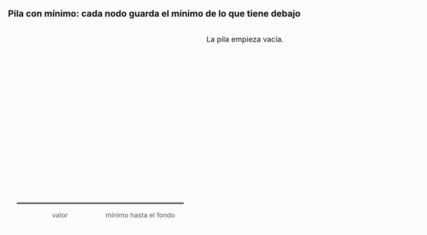

# Ejercicio 3. Una pila con mínimo en O(1)

> **Enunciado.** ★ Una pila con una operación `minimo` que cuesta $O(1)$ en el peor caso. Diseña la estructura, enuncia el invariante que la hace correcta y da el costo de cada operación. (C3)

## Respuesta

- **Estructura:** una pila enlazada en la que cada nodo guarda, además de su valor, el mínimo entre su valor y los de todos los nodos que tiene debajo.
- **Invariante:** para todo nodo $v$, el mínimo guardado en $v$ es el mínimo de los valores de $v$ y de los nodos que están debajo de $v$. Aplicado al tope, dice que `minimo` es el mínimo de la pila entera.
- **Costo:** `apilar`, `desapilar`, `tope`, `minimo` y `vacia` cuestan $O(1)$ en el peor caso. `apilar` hace una comparación y las demás ninguna. La memoria extra es un valor por nodo, $\Theta(n)$.

### Especificación y modelo

Los elementos pertenecen a un orden total. La pila tiene cinco operaciones:

- `apilar(x)` pone $x$ arriba.
- `desapilar()` quita el elemento de arriba y lo devuelve.
- `tope()` devuelve el elemento de arriba sin quitarlo.
- `minimo()` devuelve el menor elemento de la pila.
- `vacia()` dice si la pila no tiene elementos.

`desapilar`, `tope` y `minimo` tienen como precondición que la pila no esté vacía. 

### La estructura

<!-- codigo: extra_03/pila.py PilaConMinimo -->
```python
class PilaConMinimo:
    """Pila enlazada. Cada nodo es una tupla (valor, minimo, abajo): el valor,
    el mínimo de ese nodo y de todos los que tiene debajo, y el nodo de abajo."""

    def __init__(self):
        self.cima = None

    def vacia(self):
        return self.cima is None

    def apilar(self, x):
        if self.cima is None:
            self.cima = (x, x, None)
        else:
            _, m, _ = self.cima
            self.cima = (x, x if x < m else m, self.cima)

    def desapilar(self):
        x, _, abajo = self.cima
        self.cima = abajo
        return x

    def tope(self):
        return self.cima[0]

    def minimo(self):
        return self.cima[1]
```
<!-- /codigo -->

Cada nodo es una tupla `(valor, minimo, abajo)`. La pila es enlazada a propósito. Una pila sobre un arreglo dinámico, tiene `apilar` en $O(1)$ amortizado pero $\Theta(n)$ en el peor caso, cuando el arreglo se llena y se copia (C4, §1). 

### Correctitud: el invariante

Para cada nodo $v$ de la pila, sea $D(v)$ el conjunto formado por $v$ y todos los nodos que están debajo de $v$. El invariante de la estructura es

$$
v.\mathrm{minimo} = \min\{\, u.\mathrm{valor} : u \in D(v) \,\} \quad \text{para todo nodo } v. \tag{1}
$$


**Inicialización.** La pila vacía no tiene nodos, así que (1) vale trivialmente.

**Mantenimiento.** `tope`, `minimo` y `vacia` no modifican nada. Quedan las dos operaciones que cambian la pila:

- `apilar(x)` sobre la pila vacía crea un nodo $w$ con $D(w) = \{w\}$ y mínimo $x$, y (1) vale para $w$.
- `apilar(x)` sobre una pila con tope $t$ crea un nodo $w$ con $D(w) = \{w\} \cup D(t)$ y mínimo $\min(x, t.\mathrm{minimo})$. Por (1) aplicado a $t$, $t.\mathrm{minimo}$ es el mínimo de $D(t)$, así que $\min(x, t.\mathrm{minimo})$ es el mínimo de $D(w)$. Los demás nodos no cambian, y sus conjuntos $D$ tampoco, porque $w$ quedó arriba de todos.
- `desapilar()` quita el tope. Ningún otro nodo cambia, y el tope no estaba en el $D$ de ningún otro, porque estaba arriba de todos. Así que (1) sigue valiendo para los que quedan.

El paso delicado es el último. Si una operación quitara un nodo del medio, los conjuntos $D$ de los de arriba cambiarían y los mínimos guardados quedarían viejos. El invariante se sostiene porque la pila solo toca el tope.

**Conclusión.** Si $c$ es el tope, $D(c)$ es la pila entera, y por (1) `minimo()` devuelve $c.\mathrm{minimo}$, el mínimo de toda la pila. Las otras cuatro operaciones son las de una pila enlazada común y leen o escriben el tope.

### Costo

| operación | comparaciones | costo en el peor caso |
|:---|:---:|:---:|
| `apilar(x)` | 1 | $O(1)$ |
| `desapilar()` | 0 | $O(1)$ |
| `tope()` | 0 | $O(1)$ |
| `minimo()` | 0 | $O(1)$ |
| `vacia()` | 0 | $O(1)$ |

Ninguna operación tiene ciclos ni llamadas recursivas. Cada una lee o crea un número fijo de nodos de tres campos, así que todas cuestan $O(1)$ en el peor caso, y no solo amortizado. La memoria es la de una pila enlazada más un campo por nodo: $n$ valores extra para $n$ elementos.

### Conclusión

Guardar en cada nodo el mínimo de lo que tiene debajo da `minimo` en $O(1)$ en el peor caso, con una comparación por `apilar` y $n$ valores de memoria extra. El invariante (1) es el que lo hace correcto, y se sostiene porque una pila solo modifica su tope.

---

## Extras

### 1. La pila, animada

<!-- salida: extra_03/figuras.py animacion -->

<!-- /salida -->

*Figura 1. Once operaciones sobre la estructura de `pila.py`. A la derecha de cada valor está el mínimo de ese nodo hacia el fondo, y en azul el que lee `minimo()`.*

### 2. Comprobación exhaustiva

Se recorren todas las secuencias de hasta 8 operaciones con `apilar(0)`, `apilar(1)`, `apilar(2)` y `desapilar()` que nunca desapilan una pila vacía. Después de cada operación se comparan `tope()` y `minimo()` contra una lista y `min()`, y se comprueba el invariante (1) en todos los nodos de la pila:

<!-- codigo: extra_03/pila.py invariante -->
```python
def invariante(pila):
    """Comprueba el invariante en todos los nodos: el mínimo guardado en cada
    nodo es el mínimo de su valor y de todos los valores de debajo."""
    nodos = []
    nodo = pila.cima
    while nodo is not None:
        nodos.append(nodo)
        nodo = nodo[2]
    debajo = None  # mínimo de lo que está debajo del nodo actual
    for valor, minimo, _ in reversed(nodos):
        esperado = valor if debajo is None else min(valor, debajo)
        assert minimo == esperado, f"nodo {valor}: guarda {minimo}, debería {esperado}"
        debajo = esperado
```
<!-- /codigo -->

Los valores se toman de un conjunto de tres para que haya muchos empates:

<!-- salida: extra_03/pila.py exhaustivo -->
| operaciones | secuencias | operaciones comprobadas | fallos |
|---:|---:|---:|---:|
| 1 | 3 | 3 | 0 |
| 2 | 12 | 24 | 0 |
| 3 | 45 | 135 | 0 |
| 4 | 180 | 720 | 0 |
| 5 | 702 | 3,510 | 0 |
| 6 | 2,808 | 16,848 | 0 |
| 7 | 11,097 | 77,679 | 0 |
| 8 | 44,388 | 355,104 | 0 |
<!-- /salida -->

Ninguna de las casi 60 mil secuencias produce una respuesta incorrecta ni rompe el invariante.

### Cómo reproducir

El código y la animación de los extras están en `extra_03/`. Desde la carpeta del tema:

```
pip install -r requirements.txt
python -m comun.regenerar ejercicio-03.md   # recalcula tablas, animación y código de este archivo
```
