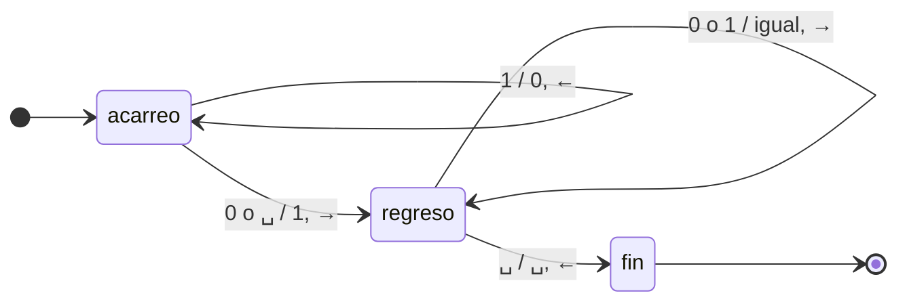
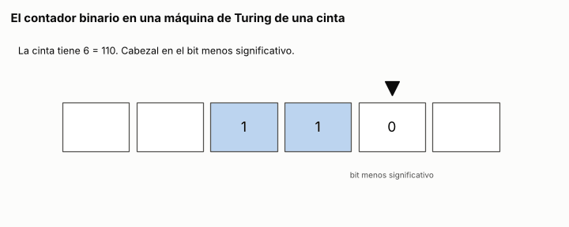
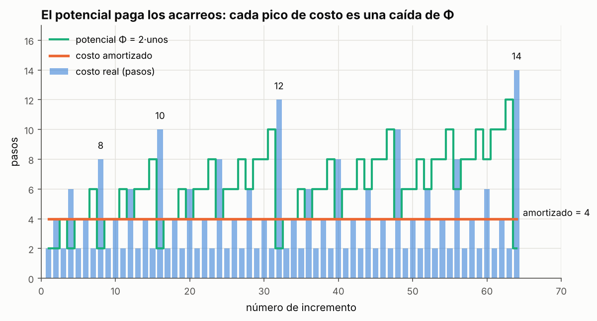

# Ejercicio 4. El contador binario en una máquina de Turing

> **Enunciado.** ★★ El contador binario en una máquina de Turing, del ejercicio 7 de la conferencia 1. Demuestra con un potencial que $m$ incrementos desde 0 cuestan $O(m)$ pasos en total, aunque uno solo pueda costar $\Theta(\log m)$. Es la pregunta que la conferencia 1 dejó abierta. (C1, C4)

## Respuesta

- **La máquina** tiene dos estados de trabajo: *acarreo*, que va hacia la izquierda convirtiendo unos en ceros, y *regreso*, que vuelve al bit menos significativo. Incrementar un número $v$ cuesta exactamente $2t(v) + 2$ pasos, donde $t(v)$ es la cantidad de unos con que termina $v$ en binario.
- **Un solo incremento** puede costar $\Theta(\log m)$: entre los $m$ primeros, el más caro cuesta $2\lfloor \log_2 m \rfloor + 2$ pasos.
- **El potencial** $\Phi = 2 \cdot (\text{cantidad de unos en la cinta})$ hace que cada incremento tenga costo amortizado exactamente $4$. Por eso $m$ incrementos desde 0 cuestan exactamente $4m - 2\,s(m) \le 4m$ pasos, donde $s(m)$ es la cantidad de unos de $m$ en binario.

### La máquina

Usamos la máquina de Turing de una cinta de C1, §3. El número está escrito en binario con el bit más significativo a la izquierda, y hay blancos ($\sqcup$) a los dos lados. El cero se escribe `0`. El cabezal empieza en el bit menos significativo y tiene que terminar ahí. Un paso es una transición.

| estado | lee | escribe | se mueve | pasa a |
|:---|:---:|:---:|:---:|:---|
| acarreo | 1 | 0 | ← | acarreo |
| acarreo | 0 | 1 | → | regreso |
| acarreo | $\sqcup$ | 1 | → | regreso |
| regreso | 0 | 0 | → | regreso |
| regreso | 1 | 1 | → | regreso |
| regreso | $\sqcup$ | $\sqcup$ | ← | fin |



**Por qué suma 1.** Si $v$ termina en un $0$ seguido de $t$ unos, $v = x\,0\,1^t$ en binario, entonces $v + 1 = x\,1\,0^t$. Si $v = 1^t$, el papel del $0$ lo hace el blanco de la izquierda, y $v + 1 = 1\,0^t$. El estado *acarreo* hace exactamente eso: convierte los $t$ unos finales en ceros, yendo hacia la izquierda, y el primer $0$ o blanco que encuentra en un $1$. Después, *regreso* camina hacia la derecha hasta el blanco que sigue al bit menos significativo y da un paso atrás, así que el cabezal termina donde empezó.

### Costo de un incremento

Sea $t = t(v)$. Contando las transiciones de cada fase:

- *acarreo* lee $t$ unos, uno por paso, y después escribe el $1$ y se mueve a la derecha: $t + 1$ pasos.
- *regreso* empieza sobre el bit que está a la derecha del $1$ recién escrito. Recorre los $t$ ceros nuevos hasta el bit menos significativo, inclusive, y da un paso más sobre el blanco para volver: $t + 1$ pasos.

$$
c(v) = 2\,t(v) + 2. \tag{1}
$$

**El peor de un incremento.** Si $v < m$ termina en $t$ unos, entonces $v \ge 2^t - 1$, así que $2^t \le v + 1 \le m$ y $t \le \lfloor \log_2 m \rfloor$. La cota se alcanza: con $k = \lfloor \log_2 m \rfloor$, el número $v = 2^k - 1 \le m - 1$ está entre los $m$ primeros y tiene $t = k$. El incremento más caro cuesta entonces

$$
2\lfloor \log_2 m \rfloor + 2 = \Theta(\log m) .
$$

Esto también responde la primera pregunta de C1, ej. 7: sobre un número de $k$ bits, el peor caso es el de $k$ unos, con $2k + 2$ pasos. Multiplicar el peor caso por $m$ da solo $O(m \log m)$ para el total. Para bajar a $O(m)$ hace falta el potencial.

### El potencial

Con el método del potencial de C4, §2, el costo amortizado del incremento $i$ es $a_i = c_i + \Phi_i - \Phi_{i-1}$, y sumando, los potenciales se telescopian:

$$
\sum_{i=1}^{m} c_i = \sum_{i=1}^{m} a_i - (\Phi_m - \Phi_0) . \tag{2}
$$

Tomamos

$$
\Phi = 2 \cdot (\text{cantidad de unos en la cinta}).
$$

**Qué deuda mide** (C4, §3). Cada $1$ de la cinta es un acarreo que algún incremento futuro va a tener que pagar, y por (1) cada acarreo cuesta dos pasos: uno para convertirlo en $0$ al ir y otro para pasar por encima al volver. Además, $\Phi_0 = 0$, porque la cinta empieza con `0`, y $\Phi \ge 0$ siempre.

**El costo amortizado es 4.** Un incremento sobre $v$ con $t = t(v)$ convierte $t$ unos en ceros y un $0$ o blanco en $1$. La cantidad de unos cambia en $1 - t$, y el potencial en $2 - 2t$. Por (1),

$$
a = (2t + 2) + (2 - 2t) = 4 .
$$

El $t$ se cancela, que es justo lo que tenía que hacer el potencial: el costo del acarreo lo pagan los unos que se destruyen.

**El total.** Después de $m$ incrementos la cinta tiene escrito $m$, así que $\Phi_m = 2\,s(m)$. Por (2),

$$
\sum_{i=1}^{m} c_i = 4m - 2\,s(m) \le 4m = O(m). \tag{3}
$$

El potencial da más de lo que pide el enunciado: la cantidad exacta de pasos.

El paso delicado es el factor $2$. El potencial que uno escribe primero, la cantidad de unos, da costo amortizado $(2t + 2) + (1 - t) = t + 3$, que no está acotado, y la demostración no cierra. Ese potencial paga la ida del acarreo, pero no la vuelta del cabezal.

### Conclusión

$m$ incrementos desde 0 cuestan exactamente $4m - 2\,s(m)$ pasos. Como $1 \le s(m) \le \lfloor \log_2 m \rfloor + 1$, el total está entre $4m - 2\lfloor \log_2 m \rfloor - 2$ y $4m - 2$: es $\Theta(m)$, aunque un solo incremento pueda costar $2\lfloor \log_2 m \rfloor + 2 = \Theta(\log m)$. En promedio sobre la secuencia, un incremento cuesta menos de $4$ pasos, y como dice C4, §1, esto no es un promedio sobre entradas al azar: vale para la secuencia de incrementos, que es una sola y está fija.

---

## Extras

### 1. La máquina, funcionando

El simulador ejecuta la tabla de transiciones tal cual:

<!-- codigo: extra_04/maquina.py TRANSICIONES, incrementar -->
```python
TRANSICIONES = {
    ("acarreo", "1"): ("0", -1, "acarreo"),
    ("acarreo", "0"): ("1", +1, "regreso"),
    ("acarreo", BLANCO): ("1", +1, "regreso"),
    ("regreso", "0"): ("0", +1, "regreso"),
    ("regreso", "1"): ("1", +1, "regreso"),
    ("regreso", BLANCO): (BLANCO, -1, "fin"),
}

def incrementar(cinta, traza=None):
    """Corre la máquina una vez sobre `cinta` (un dict posición -> símbolo,
    con el bit menos significativo en la posición 0) con el cabezal en 0.
    Devuelve el número de pasos, uno por transición. Si se pasa `traza`, le
    agrega (cinta, cabezal, estado) después de cada paso."""
    cabezal, estado, pasos = 0, "acarreo", 0
    while estado != "fin":
        escribe, mueve, estado = TRANSICIONES[(estado, cinta.get(cabezal, BLANCO))]
        cinta[cabezal] = escribe
        cabezal += mueve
        pasos += 1
        if traza is not None:
            traza.append((dict(cinta), cabezal, estado))
    assert cabezal == 0  # volvió al bit menos significativo
    return pasos
```
<!-- /codigo -->

<!-- salida: extra_04/figuras.py animacion -->

<!-- /salida -->

*Figura 1. Tres incrementos seguidos: $6 \to 7$, $7 \to 8$ y $8 \to 9$. El primero y el último cuestan 2 pasos, porque no hay unos que acarrear. El del medio es el peor caso de tres bits: el cabezal convierte los tres unos en ceros, escribe el $1$ del cuarto bit y vuelve sobre los tres ceros, $2 \cdot 3 + 2 = 8$ pasos. Las celdas en azul son los unos: el potencial es el doble de cuántas hay, y en el incremento caro bajan de 3 a 1.*

### 2. Costo real, amortizado y potencial

Con los costos medidos en el simulador, la misma figura que C4, §2 hace para la cola con dos pilas:

<!-- salida: extra_04/figuras.py costos -->

<!-- /salida -->

*Figura 2. Los 64 primeros incrementos. Las barras son el costo real, con picos de $2k + 2$ en los incrementos $2^k$, que son los que cruzan una potencia de 2. La línea escalonada es el potencial: sube 2 en cada incremento barato y se desploma en cada pico, exactamente lo que el pico cuesta de más. La línea horizontal es el costo amortizado: 4 en todos, sin excepción.*

<!-- salida: extra_04/maquina.py verificacion -->
El simulador corre los 65,536 primeros incrementos desde 0 y, en cada uno, comprueba que la cinta vale lo que debe, que el incremento costó $2t + 2$ pasos y que el total acumulado es exactamente $4m - 2\,s(m)$. Ningún `assert` falla.
<!-- /salida -->

### Cómo reproducir

El código, la figura y la animación de los extras están en `extra_04/`. Desde la carpeta del tema:

```
pip install -r requirements.txt
python -m comun.regenerar ejercicio-04.md   # recalcula la figura, la animación, la verificación y el código de este archivo
```
