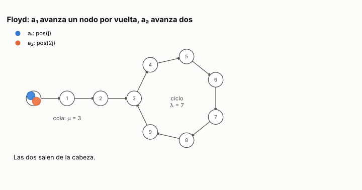

# Ejercicio 5. Detección de ciclos: el algoritmo de Floyd

> **Enunciado.** ★★ Detección de ciclos en una lista enlazada con dos punteros que avanzan a velocidades 1 y 2 (algoritmo de Floyd). Demuestra que se encuentran si y solo si hay un ciclo, con un invariante, y que termina, con un potencial. Da el costo. (C3)

## Respuesta

- **Invariante:** después de $j$ vueltas, el puntero $a_1$ está en el nodo al que se llega desde la cabeza en $j$ pasos, y $a_2$ en el que se llega en $2j$. Con eso, los punteros se encuentran en la vuelta $j$ si y solo si hay un ciclo, $a_1$ ya entró en él ($j \ge \mu$) y $j$ es múltiplo del largo del ciclo $\lambda$.
- **Potencial:** sin ciclo, $\Phi = n - 2j$. Con ciclo, $\Phi = \mu - j + \lambda$ mientras $a_1$ está en la cola, y después la distancia que $a_2$ tiene que recorrer dentro del ciclo para alcanzar a $a_1$. En los dos casos empieza en $n$ y baja en cada vuelta.
- **Costo:** $\lfloor n/2 \rfloor$ vueltas sin ciclo, y $\lambda \cdot \max(1, \lceil \mu/\lambda \rceil)$ con ciclo, que está entre $n/2$ y $n$. Es tiempo $\Theta(n)$ en todos los casos y memoria extra $O(1)$.

### El problema y el modelo

Una lista simplemente enlazada es un conjunto finito de nodos con uno distinguido, la cabeza. Cada nodo tiene un *siguiente*, que es otro nodo o *fin*. Sea $\mathrm{pos}(k)$ el resultado de tomar el siguiente $k$ veces desde la cabeza. Si en algún momento se llega a *fin*, $\mathrm{pos}$ vale *fin* de ahí en adelante. Hay que decidir si el recorrido llega alguna vez a *fin*, sin modificar la lista.

**Las dos formas posibles.** El recorrido desde la cabeza solo puede ser de dos maneras:

- **Sin ciclo.** Llega a *fin* después de pasar por $n$ nodos distintos: $\mathrm{pos}(0), \ldots, \mathrm{pos}(n-1)$ son nodos distintos y $\mathrm{pos}(n)$ es *fin*.
- **Con ciclo.** Nunca llega a *fin*. Como hay finitos nodos, alguno se repite. Sea $\mu$ el primer paso en que se llega a un nodo que después vuelve a aparecer, y $\lambda \ge 1$ la cantidad de pasos hasta que reaparece. Como el siguiente de cada nodo está fijo, a partir de ahí el recorrido se repite con período $\lambda$. La lista tiene forma de $\rho$: una cola de $\mu$ nodos y un ciclo de $\lambda$, con $n = \mu + \lambda$ nodos alcanzables desde la cabeza.

En el caso con ciclo, dos cantidades de pasos llevan al mismo nodo si y solo si son iguales, o las dos son al menos $\mu$ y difieren en un múltiplo de $\lambda$:

$$
\mathrm{pos}(a) = \mathrm{pos}(b) \iff a = b \ \ \text{o} \ \ \big(a, b \ge \mu \ \text{y} \ a \equiv b \pmod{\lambda}\big). \tag{1}
$$

**Modelo:** word RAM (C1). Tomar el siguiente de un nodo, o comparar si dos punteros señalan el mismo nodo, cuesta $1$. La memoria extra se cuenta aparte de la lista.

### El algoritmo

Dos punteros, $a_1$ y $a_2$, empiezan en la cabeza. En cada vuelta:

1. Si $a_2$ o el siguiente de $a_2$ es *fin*, el algoritmo responde que **no hay ciclo**.
2. Si no, $a_1$ avanza un nodo y $a_2$ avanza dos.
3. Si $a_1$ y $a_2$ quedaron en el mismo nodo, responde que **hay ciclo**. Si no, pasa a la vuelta siguiente.

En Python, con `None` en el papel de *fin*:

<!-- codigo: extra_05/floyd.py Nodo, hay_ciclo -->
```python
class Nodo:
    __slots__ = ("sig",)

    def __init__(self):
        self.sig = None

def hay_ciclo(cabeza):
    a1 = a2 = cabeza
    while a2 is not None and a2.sig is not None:
        a1 = a1.sig
        a2 = a2.sig.sig
        if a1 is a2:
            return True
    return False
```
<!-- /codigo -->

### Correctitud parcial: el invariante

Después de $j$ vueltas,

$$
a_1 = \mathrm{pos}(j), \qquad a_2 = \mathrm{pos}(2j). \tag{2}
$$

**Inicialización.** Con $j = 0$ los dos están en la cabeza, que es $\mathrm{pos}(0)$.

**Mantenimiento.** Se hace la vuelta $j + 1$ solo si $\mathrm{pos}(2j)$ y $\mathrm{pos}(2j+1)$ no son *fin*. Entonces ningún $\mathrm{pos}(k)$ con $k \le 2j + 1$ es *fin*. En particular $\mathrm{pos}(j+1)$ es un nodo, y es el siguiente de $a_1$. El puntero $a_2$ avanza dos veces desde $\mathrm{pos}(2j)$ y queda en $\mathrm{pos}(2j+2)$, que puede ser *fin*. Vale (2) para $j + 1$.

**Conclusión.** El algoritmo responde de dos maneras.

- **Responde "hay ciclo" en la vuelta $j \ge 1$.** Por (2), $\mathrm{pos}(j) = \mathrm{pos}(2j)$ con $j \ne 2j$, y ese valor es un nodo, porque $a_1$ siempre está sobre un nodo. Dos cantidades distintas de pasos llevan al mismo nodo, así que el recorrido se repite: hay ciclo.
- **Responde "no hay ciclo".** Lo hace porque $\mathrm{pos}(2j)$ o $\mathrm{pos}(2j+1)$ es *fin*. El recorrido llega a *fin*: no hay ciclo.

Por (1), además, se sabe exactamente cuándo se encuentran. Como $j \ne 2j$, $\mathrm{pos}(j) = \mathrm{pos}(2j)$ exige $j \ge \mu$ y $2j \equiv j \pmod \lambda$, es decir:

$$
a_1 \text{ y } a_2 \text{ se encuentran en la vuelta } j \ge 1 \iff \text{hay ciclo}, \ \ j \ge \mu \ \ \text{y} \ \ \lambda \mid j . \tag{3}
$$

**El "si y solo si".** Si se encuentran, hay ciclo: es el primer caso de la conclusión. Recíprocamente, si hay ciclo, $\mathrm{pos}(k)$ nunca es *fin* y el algoritmo no puede responder "no hay ciclo". Falta ver que termina, porque entonces tiene que responder "hay ciclo", y eso es que se encontraron. Lo da el potencial.

### Terminación: el potencial

**Sin ciclo.** Sea $\Phi_j = n - 2j$. Si se hace la vuelta $j + 1$, $\mathrm{pos}(2j+1)$ no es *fin*, así que $2j + 1 \le n - 1$ y $\Phi_j \ge 2$. Cada vuelta lo baja en $2$. Es un entero no negativo que baja, así que el algoritmo termina.

**Con ciclo.** Sea

$$
\Phi_j = \begin{cases} \mu - j + \lambda & \text{si } j < \mu \ \ (a_1 \text{ todavía está en la cola}), \\ \lambda - (j \bmod \lambda) & \text{si } j \ge \mu \ \ (\text{los dos están en el ciclo}). \end{cases}
$$

Mientras no se hayan encontrado, el segundo caso es $(-j) \bmod \lambda$. Como $a_2$ está en $\mathrm{pos}(2j)$ y $a_1$ en $\mathrm{pos}(j)$, a $a_2$ le faltan exactamente $(j - 2j) \bmod \lambda$ pasos dentro del ciclo para llegar a $a_1$. Cuando $\mu = 0$ y los dos están todavía en la cabeza, cuenta como una vuelta completa: $\Phi_0 = \lambda$. El potencial es un entero, vale al menos $1$ mientras el algoritmo sigue, y baja en cada vuelta:

- Si $j < \mu - 1$, $a_1$ sigue en la cola y $\Phi_{j+1} = \Phi_j - 1$.
- Si $j = \mu - 1$, $a_1$ entra al ciclo: $\Phi_j = \lambda + 1$ y $\Phi_{j+1} = \lambda - (\mu \bmod \lambda) \le \lambda$.
- Si $j \ge \mu$ y $\Phi_j \ge 2$, entonces $j \bmod \lambda \le \lambda - 2$, así que $(j+1) \bmod \lambda = (j \bmod \lambda) + 1$ y $\Phi_{j+1} = \Phi_j - 1$: $a_2$ se acerca un nodo.
- Si $j \ge \mu$ y $\Phi_j = 1$, entonces $\lambda \mid j + 1$ y $j + 1 > \mu$. Por (3), se encuentran en la vuelta $j + 1$ y el algoritmo responde. No hay vuelta siguiente.

Así que el algoritmo termina. Como $\Phi_0 = \mu + \lambda = n$ si $\mu \ge 1$, y $\Phi_0 = \lambda = n$ si $\mu = 0$, el valor inicial acota las vueltas por $n$ (C3, §1).

El paso delicado es el tercer caso. Por cada vuelta, $a_2$ se acerca a $a_1$ **exactamente un nodo**, porque avanza uno más que él. Por eso la distancia pasa por todos los valores hasta $1$ y no puede saltarse el encuentro.

### Costo

Cada vuelta toma tres siguientes y hace a lo sumo tres comparaciones: $O(1)$. La cantidad exacta de vueltas sale de la condición del paso 1 y de (3):

$$
V = \begin{cases} \lfloor n/2 \rfloor & \text{sin ciclo}, \\ \lambda \cdot \max\!\big(1, \lceil \mu / \lambda \rceil\big) & \text{con ciclo}. \end{cases} \tag{4}
$$

Sin ciclo, se hace la vuelta $j + 1$ mientras $2j + 1 \le n - 1$, es decir, para $j = 0, \ldots, \lfloor n/2 \rfloor - 1$. Con ciclo, $V$ es el menor $j \ge 1$ con $j \ge \mu$ y $\lambda \mid j$.

Con ciclo, $V$ es un múltiplo positivo de $\lambda$ y es al menos $\mu$, así que $V \ge \max(\mu, \lambda) \ge n/2$. Y $V \le n$: si $\mu = 0$, $V = \lambda = n$; si $\mu \ge 1$, el menor múltiplo de $\lambda$ que es al menos $\mu$ es menor que $\mu + \lambda = n$. Entonces

$$
\frac{n}{2} \le V \le n \quad \text{con ciclo}, \qquad V = \left\lfloor \frac{n}{2} \right\rfloor \quad \text{sin ciclo}.
$$

El tiempo es $\Theta(n)$ en todos los casos, no solo en el peor. La memoria extra son dos punteros: $O(1)$. Guardar los nodos visitados en una tabla hash también detecta el ciclo en tiempo $O(n)$ esperado, pero con memoria $\Theta(n)$. La razón de ser de Floyd es la memoria.

### Conclusión

Por el invariante (2) y la forma de la lista (1), los punteros se encuentran exactamente cuando hay ciclo, $a_1$ entró en él y $\lambda \mid j$. Por el potencial, que mide lo que le falta a $a_1$ para entrar al ciclo y, adentro, la distancia de $a_2$ hasta $a_1$, el algoritmo termina en a lo sumo $n$ vueltas. Hace exactamente las vueltas de (4), que son $\Theta(n)$, con memoria $O(1)$.

---

## Extras

### 1. Los dos punteros, sobre la $\rho$

<!-- salida: extra_05/figuras.py animacion -->

<!-- /salida -->

*Figura 1. Una lista con $\mu = 3$ y $\lambda = 7$. Mientras $a_1$ recorre la cola, el potencial baja de a uno. Cuando $a_1$ entra al ciclo, en la vuelta 3, $a_2$ está 4 nodos detrás de él dentro del ciclo, y a partir de ahí la distancia baja de a uno: 4, 3, 2, 1. Se encuentran en la vuelta 7, que es el menor múltiplo de $\lambda$ que es al menos $\mu$, como dice (4).*

### Cómo reproducir

El código y la animación del extra están en `extra_05/`. Desde la carpeta del tema:

```
pip install -r requirements.txt
python -m comun.regenerar ejercicio-05.md   # recalcula la animación y el código de este archivo
```
