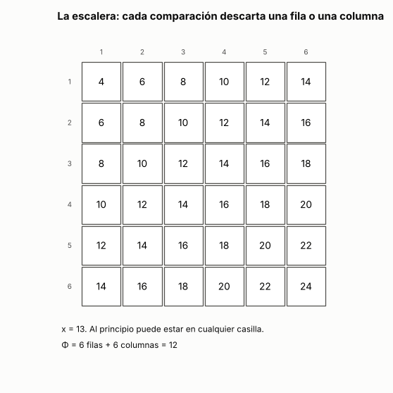
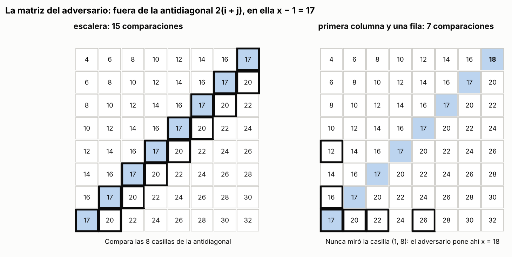

# Ejercicio 6. Buscar en una matriz con filas y columnas ordenadas

> **Enunciado.** ★★ Una matriz $n \times n$ tiene filas y columnas ordenadas de forma creciente. Diseña un algoritmo que decida si contiene un valor $x$ en $O(n)$ comparaciones, demuestra su correctitud con un invariante, y demuestra con un adversario que no se puede en $o(n)$. (C3, C5)

## Respuesta

- **Algoritmo:** la *escalera*. Empieza en la esquina de arriba a la derecha y en cada comparación descarta una fila entera, si $x$ es mayor, o una columna entera, si $x$ es menor. Hace a lo sumo $2n - 1$ comparaciones, y ese número se alcanza.
- **Invariante:** si $x$ está en la matriz, está en la submatriz que todavía no se descartó, la de las filas $i, \ldots, n$ y las columnas $1, \ldots, j$. El potencial $\Phi = (\text{filas que quedan}) + (\text{columnas que quedan})$ empieza en $2n$ y baja uno por comparación.
- **Cota mínima:** las $n$ casillas de la antidiagonal se pueden elegir de forma independiente sin romper el orden. Un adversario obliga a comparar $x$ con cada una, así que hacen falta al menos $n$ comparaciones. El problema cuesta $\Theta(n)$.

### El problema y el modelo

La matriz $M$ tiene filas $i = 1, \ldots, n$, de arriba hacia abajo, y columnas $j = 1, \ldots, n$, de izquierda a derecha. Las filas y las columnas son crecientes:

$$
M_{i,j} \le M_{i,j+1}, \qquad M_{i,j} \le M_{i+1,j}.
$$

El algoritmo funciona con desigualdades no estrictas. Las matrices del adversario son estrictamente crecientes, así que la cota mínima vale aunque se exija orden estricto.

**Modelo:** comparaciones, como en la búsqueda de C5, §3. El algoritmo solo accede a la matriz comparando $x$ con una casilla, la respuesta es $<$, $=$ o $>$, y el costo es el número de comparaciones.

### El algoritmo

El algoritmo guarda una fila $i$, que empieza en $1$, y una columna $j$, que empieza en $n$. La casilla $(i, j)$ es la esquina de arriba a la derecha de lo que todavía no se descartó. Mientras queden filas y columnas, es decir, mientras $i \le n$ y $j \ge 1$, compara $x$ con $M_{i,j}$:

1. Si $x = M_{i,j}$, responde que **$x$ está**.
2. Si $x < M_{i,j}$, descarta la columna $j$: pasa a $j - 1$.
3. Si $x > M_{i,j}$, descarta la fila $i$: pasa a $i + 1$.

Cuando no quedan filas o no quedan columnas, responde que **$x$ no está**.

En Python, con filas y columnas numeradas desde 0 y la matriz accesible solo a través de `comparar`:

<!-- codigo: extra_06/matriz.py escalera -->
```python
def escalera(n, comparar):
    """Busca x en una matriz n × n. `comparar(i, j)` devuelve -1, 0 o 1 según
    x sea menor, igual o mayor que M[i][j]: es la única forma de mirar la
    matriz. Devuelve (está, casillas comparadas en orden)."""
    i, j = 0, n - 1  # la esquina de arriba a la derecha
    camino = []
    while i < n and j >= 0:
        camino.append((i, j))
        r = comparar(i, j)
        if r == 0:
            return True, camino
        if r < 0:
            j -= 1  # x es menor que todo lo que queda en la columna j
        else:
            i += 1  # x es mayor que todo lo que queda en la fila i
    return False, camino
```
<!-- /codigo -->

### Correctitud: el invariante

Antes de cada comparación,

$$
1 \le i \le n + 1, \qquad 0 \le j \le n, \qquad \text{y si } x = M_{k,l}, \text{ entonces } k \ge i \text{ y } l \le j. \tag{1}
$$

Es decir, $x$ no está en las filas $1, \ldots, i - 1$ ni en las columnas $j + 1, \ldots, n$: solo puede estar en la submatriz de abajo a la izquierda que empieza en $(i, j)$.

**Inicialización.** Con $i = 1$ y $j = n$ no hay filas antes de la $1$ ni columnas después de la $n$, así que (1) vale.

**Mantenimiento.** Hay un caso por respuesta:

- Si $x = M_{i,j}$, el algoritmo responde "está", y es correcto.
- Si $x < M_{i,j}$: para toda fila $k \ge i$, la columna creciente da $M_{k,j} \ge M_{i,j} > x$. Entonces $x$ no está en la columna $j$ dentro de las filas que quedan, y las filas anteriores ya estaban descartadas por (1). Vale (1) con $j - 1$.
- Si $x > M_{i,j}$: para toda columna $l \le j$, la fila creciente da $M_{i,l} \le M_{i,j} < x$. Entonces $x$ no está en la fila $i$ dentro de las columnas que quedan, y las columnas posteriores ya estaban descartadas. Vale (1) con $i + 1$.

**Conclusión.** Si el algoritmo termina sin encontrar $x$, es porque $i = n + 1$ o $j = 0$. En los dos casos no existe ninguna casilla $(k, l)$ con $k \ge i$ y $l \le j$, así que por (1) $x$ no está en la matriz, y la respuesta "no está" es correcta.

### Terminación y costo: el potencial

Sea

$$
\Phi = (n - i + 1) + j,
$$

la cantidad de filas más la cantidad de columnas que quedan. Es un entero, empieza en $2n$, y antes de cada comparación vale al menos $2$, porque quedan al menos una fila y una columna. Cada comparación que no encuentra $x$ descarta exactamente una fila o una columna, así que baja $\Phi$ en exactamente $1$. Por eso el algoritmo termina, y antes de la última comparación $\Phi$ bajó a lo sumo de $2n$ a $2$:

$$
C(n) \le 2n - 1 = O(n). \tag{2}
$$


**La cota (2) se alcanza.** Sea $M_{i,j} = 2(i + j)$ y $x = 2n + 1$, que no está. Las casillas con $i + j = n + 1$ valen $2n + 2 > x$, y las de $i + j = n$ valen $2n < x$. Empezando en $(1, n)$, donde $i + j = n + 1$, el algoritmo va a la izquierda. Llega a una casilla con $i + j = n$ y baja. Vuelve a una con $i + j = n + 1$, y así alterna. Recorre la escalera entera hasta $(n, 1)$ y sale por la izquierda: son $2n - 1$ comparaciones (extra 1).

### Cota mínima: el adversario

Fijemos $x = 2(n + 1)$ y la matriz $B$ que vale $2(i + j)$ fuera de la antidiagonal y $x - 1$ en la antidiagonal, es decir, en las casillas con $i + j = n + 1$. Para cada fila $k$, sea $B^{(k)}$ la misma matriz pero con $x$ en la casilla $(k, n + 1 - k)$ de la antidiagonal.

**Todas son matrices válidas.** Fuera de la antidiagonal, $2(i + j)$ crece hacia la derecha y hacia abajo. Una casilla de la antidiagonal tiene a su izquierda y arriba casillas con $i + j = n$, que valen $2n < x - 1$, y a su derecha y abajo casillas con $i + j = n + 2$, que valen $2n + 4 > x$. Dos casillas de la antidiagonal nunca comparten fila ni columna. Así que cada casilla de la antidiagonal puede valer $x - 1$ o $x$ sin romper el orden, y $B$ y todas las $B^{(k)}$ tienen filas y columnas estrictamente crecientes.

**$B$ no contiene a $x$; cada $B^{(k)}$ sí.** Fuera de la antidiagonal, $2(i + j) = 2(n + 1)$ solo si $i + j = n + 1$, así que ninguna de esas casillas vale $x$. En $B$ la antidiagonal vale $x - 1$, y en $B^{(k)}$ hay exactamente una casilla igual a $x$.

**El adversario** (C5, §5) contesta todas las comparaciones como si la matriz fuera $B$. Supongamos que un algoritmo termina después de menos de $n$ comparaciones. Entonces hay una casilla de la antidiagonal, la de alguna fila $k$, con la que nunca comparó $x$. Como $B$ y $B^{(k)}$ difieren solo en esa casilla, todas las comparaciones que hizo tienen la misma respuesta en las dos matrices. El algoritmo recorre el mismo camino y da la misma respuesta en las dos. Pero en $B$ la respuesta correcta es "no está" y en $B^{(k)}$ es "está", así que se equivoca en una.

Entonces todo algoritmo correcto compara $x$ con las $n$ casillas de la antidiagonal sobre $B$, y hace al menos

$$
n \tag{3}
$$

comparaciones en el peor caso. Ningún algoritmo del modelo lo hace en $o(n)$.

### Conclusión

La escalera decide si $x$ está en a lo sumo $2n - 1$ comparaciones (2). El invariante (1) dice que nunca descarta la casilla de $x$, y el potencial, que nunca da más de $2n - 1$ pasos. El adversario de la antidiagonal obliga a cualquier algoritmo a hacer al menos $n$ (3). El problema cuesta $\Theta(n)$ comparaciones.

---

## Extras

### 1. La escalera, animada

<!-- salida: extra_06/figuras.py animacion -->

<!-- /salida -->

*Figura 1. La escalera sobre $M_{i,j} = 2(i + j)$ con $x = 13$, el caso que alcanza la cota (2). En azul, las filas descartadas porque todo lo que les queda es menor que $x$; en rojo, las columnas descartadas porque todo lo que les queda es mayor. Lo blanco es la submatriz donde, por el invariante (1), todavía puede estar $x$. Cada comparación pinta una fila o una columna y baja $\Phi$ en uno: de 12 a 1 en 11 comparaciones, $2n - 1$ con $n = 6$.*

### 2. El adversario, ejecutado

Contesta como si la matriz fuera $B$, anota con qué casillas de la antidiagonal comparó el algoritmo, y si quedó alguna sin mirar construye la $B^{(k)}$ en la que la respuesta es falsa y comprueba que el algoritmo, corrido sobre ella, responde lo mismo. Lo enfrentamos con tres algoritmos:

- la escalera;
- una búsqueda binaria en cada fila, correcta pero más cara;
- buscar con búsqueda binaria, en la primera columna, la última fila que empieza con un valor menor o igual que $x$, y buscar $x$ en esa fila. Sería correcto si la matriz estuviera ordenada leída fila tras fila, y hace solo $O(\log n)$ comparaciones.

<!-- salida: extra_06/matriz.py adversario -->
| algoritmo | n | comparaciones | antidiagonal comparada | el adversario lo engaña |
|:---|---:|---:|---:|:---:|
| escalera | 8 | 15 | 8 de 8 | no |
| escalera | 64 | 127 | 64 de 64 | no |
| búsqueda binaria en cada fila | 8 | 25 | 8 de 8 | no |
| búsqueda binaria en cada fila | 64 | 385 | 64 de 64 | no |
| primera columna y después una fila | 8 | 7 | 1 de 8 | sí |
| primera columna y después una fila | 64 | 13 | 1 de 64 | sí |
<!-- /salida -->

<!-- salida: extra_06/figuras.py adversario -->

<!-- /salida -->

*Figura 2. La matriz $B$ con $n = 8$. Las casillas con borde grueso son las que cada algoritmo comparó con $x$. La escalera pasa por las 8 de la antidiagonal, en azul. El algoritmo de la primera columna mira solo una, y el adversario pone $x$ en otra que nunca miró.*

<!-- salida: extra_06/matriz.py trampa -->
Con $n = 4$ y $x = 10$, el algoritmo de la primera columna da la misma respuesta en $B$, que no contiene a $x$, y en $B^{(1)}$, que lo tiene en la casilla $(1, 4)$, que nunca miró:

```
     4   6   8  10
     6   8   9  12
     8   9  12  14
     9  12  14  16
```
<!-- /salida -->

La cota (3) ya decía, sin correr nada, que el algoritmo de la primera columna estaba mal: hace $O(\log n)$ comparaciones, menos que las $n$ que todo algoritmo correcto necesita. Es el uso de la cota mínima como detector de errores de C5, §8, y el adversario es la receta para construir la entrada donde falla. Los dos algoritmos correctos, en cambio, miran la antidiagonal completa, como exige la demostración.

### Cómo reproducir

El código, la figura y la animación de los extras están en `extra_06/`. Desde la carpeta del tema:

```
pip install -r requirements.txt
python -m comun.regenerar ejercicio-06.md   # recalcula la tabla, la figura, la animación y el código de este archivo
```
