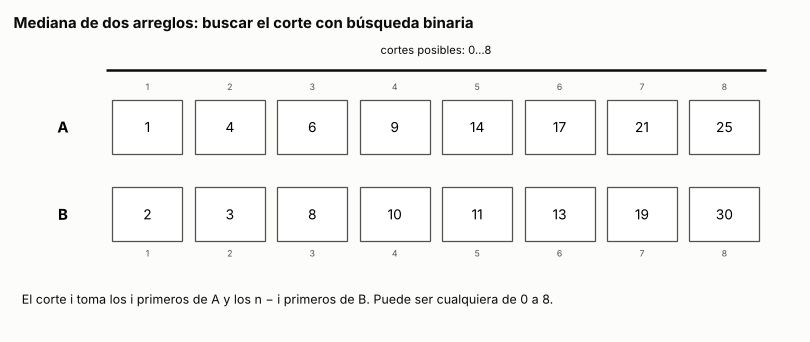
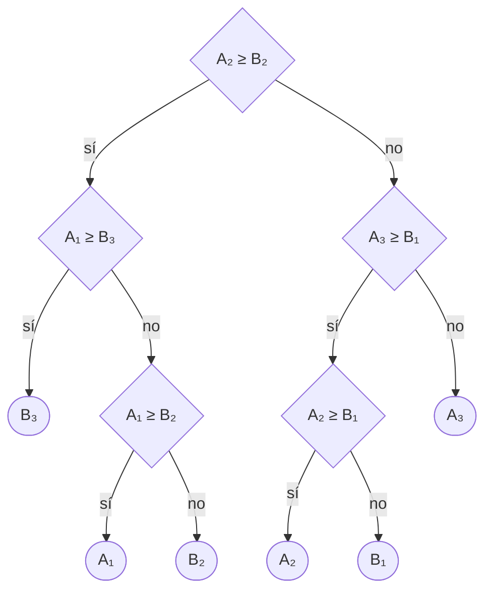

# Ejercicio 7. Mediana de dos arreglos ordenados

> **Enunciado.** ★★★ Mediana de dos arreglos ordenados de largo $n$: el $n$-ésimo menor de los $2n$ elementos. Diseña un algoritmo $O(\log n)$, demuestra su correctitud y da la cota de información. (C2, C3, C5)

## Respuesta

- **Algoritmo:** buscar el *corte*. Los $n$ menores de los $2n$ elementos son los $i$ primeros de $A$ y los $n - i$ primeros de $B$ para algún $i$ entre $0$ y $n$, y ese $i$ se encuentra con búsqueda binaria preguntando "¿$A_{i+1} \ge B_{n-i}$?". La mediana es $\max(A_i, B_{n-i})$. En total hace a lo sumo $\lceil \log_2(n+1) \rceil + 1$ comparaciones, con memoria $O(1)$.
- **Correctitud:** la pregunta es monótona en $i$, y el primer $i$ donde es verdadera es un corte válido. El invariante de la búsqueda dice que ese $i$ queda siempre entre $lo$ y $hi$, y el potencial $hi - lo$ se reduce a la mitad en cada vuelta.
- **Cota de información:** cada una de las $2n$ posiciones puede ser la mediana, así que el árbol de decisión de cualquier algoritmo de comparaciones necesita $2n$ hojas y altura al menos $\lceil \log_2 2n \rceil = 1 + \lceil \log_2 n \rceil$. El costo del algoritmo coincide con la cota salvo cuando $n$ es potencia de 2, donde la supera en una comparación. El problema cuesta $\Theta(\log n)$.

### El problema y el modelo

Tenemos dos arreglos no decrecientes de largo $n \ge 1$,

$$
A_1 \le A_2 \le \cdots \le A_n, \qquad B_1 \le B_2 \le \cdots \le B_n,
$$

y buscamos el $n$-ésimo menor de los $2n$ elementos: el que queda en el lugar $n$ si se ordenan todos juntos. Con valores repetidos, ese valor está bien definido aunque haya varias posiciones que lo tengan.

**Modelo:** comparaciones, como en C5, §1. El algoritmo puede leer cualquier posición en tiempo constante, pero sobre los valores solo sabe lo que le contestan las comparaciones entre dos elementos, y su costo es el número de comparaciones. Como no puede fabricar valores, su salida es una posición: "la mediana es $A_k$" o "la mediana es $B_k$".

Para no separar casos en los bordes, convenimos que $A_0 = B_0 = -\infty$ y $A_{n+1} = B_{n+1} = +\infty$. Son solo notación: el algoritmo nunca compara con ellos.

### El algoritmo

Llamamos *corte* $i$, con $0 \le i \le n$, a quedarse con los $i$ primeros de $A$ y los $n - i$ primeros de $B$, que son $n$ elementos. El algoritmo busca el corte con dos índices $lo$ y $hi$, que empiezan en $0$ y $n$. Mientras $lo < hi$, toma el corte del medio, $i = \lfloor (lo + hi)/2 \rfloor$, y compara el primero que queda afuera en $A$ con el último que entra de $B$:

1. Si $A_{i+1} \ge B_{n-i}$, el corte buscado es $i$ o uno menor: pasa a $hi = i$.
2. Si no, el corte buscado es mayor que $i$: pasa a $lo = i + 1$.

Cuando $lo = hi$, ese es el corte $i$, y la mediana es el mayor de los $n$ elementos que entran: $\max(A_i, B_{n-i})$. Si $i = 0$ es $B_n$ y si $i = n$ es $A_n$, sin comparar. Si no, una comparación más decide cuál de los dos es.

Dentro del ciclo $lo \le i < hi \le n$, así que $A_{i+1}$ y $B_{n-i}$ son siempre elementos de verdad, con índices entre $1$ y $n$.

En Python, con posiciones desde 0 y los elementos accesibles solo a través de `mayor_o_igual`:

<!-- codigo: extra_07/mediana.py mediana -->
```python
def mediana(A, B, mayor_o_igual=lambda x, y: x >= y):
    """El n-ésimo menor de los 2n elementos de A y B, ordenados y de largo
    n ≥ 1. `mayor_o_igual(x, y)` es la única forma de comparar elementos.
    Devuelve (lado, posición) del elemento: ("A", k) o ("B", k)."""
    n = len(A)
    lo, hi = 0, n  # el corte buscado está en [lo, hi]
    while lo < hi:
        i = (lo + hi) // 2
        if mayor_o_igual(A[i], B[n - i - 1]):  # A_{i+1} ≥ B_{n−i}
            hi = i
        else:
            lo = i + 1
    i = lo  # se toman los i primeros de A y los n − i primeros de B
    if i == 0:
        return "B", n - 1
    if i == n:
        return "A", n - 1
    return ("A", i - 1) if mayor_o_igual(A[i - 1], B[n - i - 1]) else ("B", n - i - 1)
```
<!-- /codigo -->

### Correctitud

La demostración tiene tres pasos: qué corte sirve, por qué la búsqueda lo encuentra, y por qué el ciclo lo deja entre $lo$ y $hi$.

**Un corte válido da la mediana.** Decimos que el corte $i$ es *válido* si

$$
A_i \le B_{n-i+1} \qquad \text{y} \qquad B_{n-i} \le A_{i+1}. \tag{1}
$$

Los que entran son $A_1, \ldots, A_i$ y $B_1, \ldots, B_{n-i}$, y el mayor de ellos es $\max(A_i, B_{n-i})$, porque los dos arreglos son no decrecientes. Los que quedan afuera son $A_{i+1}, \ldots, A_n$ y $B_{n-i+1}, \ldots, B_n$, y el menor es $\min(A_{i+1}, B_{n-i+1})$. Las cuatro desigualdades

$$
A_i \le A_{i+1}, \qquad A_i \le B_{n-i+1}, \qquad B_{n-i} \le B_{n-i+1}, \qquad B_{n-i} \le A_{i+1}
$$

valen por el orden y por (1), así que todo lo que entra es menor o igual que todo lo que queda afuera. Entonces, poniendo primero los $n$ que entran, en orden, y después los otros $n$, en orden, se obtiene los $2n$ elementos ordenados, y el lugar $n$ lo ocupa el mayor de los que entran. La mediana es $\max(A_i, B_{n-i})$.

**El primer corte donde la respuesta es "sí" es válido.** Sea $f(i)$ la respuesta a la pregunta del algoritmo en el corte $i$, es decir, si $A_{i+1} \ge B_{n-i}$, para $0 \le i \le n$.

- $f(n)$ es "sí", porque $A_{n+1} = +\infty$.
- $f$ es monótona: si $f(i)$ es "sí" y $i < j$, entonces $A_{j+1} \ge A_{i+1} \ge B_{n-i} \ge B_{n-j}$, y $f(j)$ también es "sí".

Así que $f$ dice "no" en un prefijo de los cortes y "sí" en el resto. Sea $i^*$ el primer corte donde dice "sí", que existe porque $f(n)$ es "sí". La segunda desigualdad de (1) para $i^*$ es justamente $f(i^*)$. Para la primera, si $i^* = 0$ vale porque $A_0 = -\infty$, y si $i^* > 0$, $f(i^* - 1)$ es "no", es decir, $A_{i^*} < B_{n-i^*+1}$. El corte $i^*$ es válido.

**El ciclo encuentra $i^*$.** Antes de cada vuelta,

$$
0 \le lo \le i^* \le hi \le n, \tag{2}
$$

que por la monotonía de $f$ es lo mismo que decir que $f$ es "no" en todo corte menor que $lo$ y "sí" en $hi$.

- **Inicialización.** Con $lo = 0$ y $hi = n$, (2) vale porque $i^*$ es un corte.
- **Mantenimiento.** Sea $i = \lfloor (lo + hi)/2 \rfloor$. Si $f(i)$ es "sí", entonces $i^* \le i$ por ser $i^*$ el primero, y (2) vale con $hi = i$. Si $f(i)$ es "no", la monotonía dice que $f$ es "no" en todos los cortes hasta $i$, así que $i^* \ge i + 1$, y (2) vale con $lo = i + 1$.
- **Conclusión.** El ciclo termina con $lo = hi$, y por (2) ese valor es $i^*$.

Juntando los tres pasos, el algoritmo termina en el corte válido $i^*$ y responde $\max(A_{i^*}, B_{n-i^*})$, que es la mediana.

### Terminación y costo: el potencial

El potencial es $\Phi = hi - lo$, la cantidad de cortes que quedan menos uno. Es un entero no negativo y empieza en $n$. Es la misma búsqueda binaria del ejercicio 2, sobre $n + 1$ cortes en vez de $n + 1$ huecos, y la cuenta es la misma: si $hi$ pasa a ser $i$, el potencial nuevo es $\lfloor \Phi/2 \rfloor$, y si $lo$ pasa a ser $i + 1$, es $\lceil \Phi/2 \rceil - 1$. En los dos casos

$$
\Phi' \le \lfloor \Phi/2 \rfloor ,
$$

así que después de $j$ vueltas $\Phi \le \lfloor n / 2^j \rfloor$, y con $j = \lfloor \log_2 n \rfloor + 1$ ya vale $0$. El ciclo hace a lo sumo $\lfloor \log_2 n \rfloor + 1 = \lceil \log_2(n+1) \rceil$ comparaciones, y el final, a lo sumo una más:

$$
C(n) \le \lceil \log_2(n+1) \rceil + 1 = O(\log n). \tag{3}
$$

Cada vuelta hace trabajo constante y la memoria extra es $O(1)$: dos índices. Para $2 \le n \le 8$, la tabla del extra 2 muestra que el peor caso es exactamente (3).

### Cota de información

Para la cota alcanza con mirar entradas de valores distintos: si un algoritmo necesita muchas comparaciones en algunas entradas, su peor caso sobre todas es al menos ese.

**Cada una de las $2n$ posiciones puede ser la mediana.** Para $A_k$: se reparten los valores $1, \ldots, n$ entre $B_1, \ldots, B_{n-k}$ y después $A_1, \ldots, A_k$, en ese orden, y los valores $n + 1, \ldots, 2n$ entre los elementos que quedan, también en orden. Los $n$ menores valen $1, \ldots, n$, y el mayor de ellos, el que vale $n$, es $A_k$. Para $B_k$ es lo mismo cambiando los papeles de $A$ y $B$.

**Medianas en posiciones distintas necesitan hojas distintas.** Fijemos un algoritmo correcto y su árbol de decisión (C5, §2). Cada comparación tiene dos respuestas, así que el árbol es binario. Con valores distintos, una sola posición tiene el $n$-ésimo menor valor. Si dos entradas cuyas medianas están en posiciones distintas llegaran a la misma hoja, recibirían la misma posición como respuesta, y estaría mal para una de las dos.

Entonces el árbol tiene al menos $2n$ hojas, y por el lema 1 de C5, §3, su altura $h$ cumple $2^h \ge 2n$:

$$
h \ge \lceil \log_2 2n \rceil = 1 + \lceil \log_2 n \rceil . \tag{4}
$$


### Conclusión

La búsqueda del corte encuentra la mediana en a lo sumo $\lceil \log_2(n+1) \rceil + 1$ comparaciones (3). La monotonía de la pregunta y el invariante (2) garantizan que termina en un corte válido, que por (1) da la mediana, y el potencial $hi - lo$, que lo hace en $O(\log n)$ vueltas. La cota de información (4) dice que todo algoritmo de comparaciones necesita al menos $1 + \lceil \log_2 n \rceil$. El problema cuesta $\Theta(\log n)$, y el algoritmo alcanza la cota exacta salvo una comparación cuando $n$ es potencia de 2.

---

## Extras

### 1. La búsqueda del corte, animada

<!-- salida: extra_07/figuras.py animacion -->

<!-- /salida -->

*Figura 1. La búsqueda sobre dos arreglos de ocho elementos. Las líneas naranjas marcan el corte $i$ en $A$ y el corte $n - i$ en $B$, y los recuadros gruesos son los dos elementos que se comparan, $A_{i+1}$ y $B_{n-i}$. La barra negra son los cortes que el invariante (2) todavía permite. En el último cuadro, en azul, los $n$ menores. La mediana es el mayor de ellos, $B_4 = 10$. Son tres comparaciones del ciclo y una final.*

### 2. El árbol de decisión y la verificación completa

Corriendo el algoritmo sobre todas las formas de intercalar los elementos de $A$ con los de $B$ y pegando las ejecuciones por donde coinciden (C5, §2) sale su árbol de decisión. Para $n = 3$:

<!-- salida: extra_07/mediana.py arbol -->

<!-- /salida -->

Tiene una hoja por cada una de las 6 posiciones y altura 3, que es la cota (4) para $n = 3$: el algoritmo es óptimo. El programa comprueba, mientras arma el árbol, que la pregunta de cada nodo es la misma para todas las entradas que pasan por él.

Con valores distintos, todo lo que un algoritmo de comparaciones puede distinguir es cómo se intercalan $A$ y $B$, y hay $\binom{2n}{n}$ formas. Recorrerlas todas es una verificación completa del algoritmo para cada $n$:

<!-- salida: extra_07/mediana.py cuentas -->
| n | intercalaciones | salidas distintas | peor caso medido | ⌈log₂(n+1)⌉ + 1 | cota ⌈log₂ 2n⌉ |
|---:|---:|---:|---:|---:|---:|
| 1 | 2 | 2 | 1 | 2 | 1 |
| 2 | 6 | 4 | 3 | 3 | 2 |
| 3 | 20 | 6 | 3 | 3 | 3 |
| 4 | 70 | 8 | 4 | 4 | 3 |
| 5 | 252 | 10 | 4 | 4 | 4 |
| 6 | 924 | 12 | 4 | 4 | 4 |
| 7 | 3,432 | 14 | 4 | 4 | 4 |
| 8 | 12,870 | 16 | 5 | 5 | 4 |
<!-- /salida -->

En todas las intercalaciones la respuesta coincide con el lugar $n$ de los $2n$ elementos ordenados. La columna de salidas distintas confirma que las $2n$ posiciones aparecen como mediana. El peor caso medido es exactamente (3) desde $n = 2$, y supera a la cota (4) justo en $n = 2, 4, 8$, las potencias de 2. Con $n = 1$ el ciclo termina siempre en un borde y la comparación final no hace falta, por eso el peor caso es 1.

### Cómo reproducir

El código y la animación de los extras están en `extra_07/`. Desde la carpeta del tema:

```
pip install -r requirements.txt
python -m comun.regenerar ejercicio-07.md   # recalcula la animación, el árbol, la tabla y el código de este archivo
```
