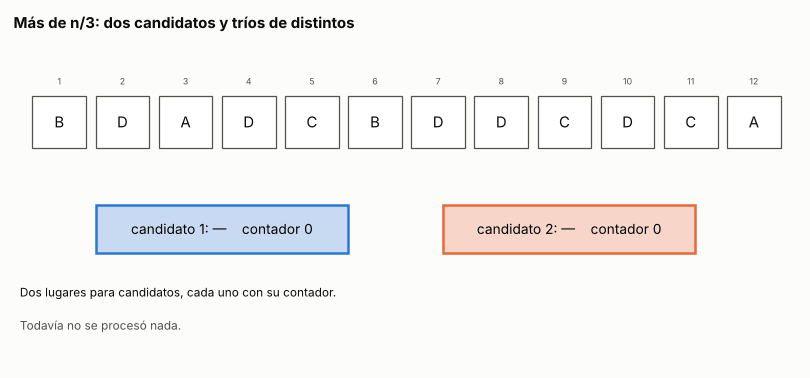

# Ejercicio 8. Los elementos que aparecen más de n/3 veces

> **Enunciado.** ★★ El elemento que aparece más de $n/3$ veces. Generaliza Boyer-Moore con dos candidatos, enuncia el invariante reforzado y demuéstralo. Después escribe la versión que devuelve los candidatos con contador positivo sin verificarlos, y busca un generador de pruebas que no la atrape. Cuidado: el análogo del generador binario de la conferencia 3 sí la atrapa. (C3)

## Respuesta

- **Algoritmo:** dos candidatos, cada uno con su contador. Un elemento igual a un candidato le suma una copia. Uno distinto de los dos ocupa un lugar libre si lo hay, y si no, se cancela con una copia de cada candidato. Una segunda pasada cuenta los candidatos. Tiempo $O(n)$, a lo sumo $4n$ comparaciones de igualdad, y memoria $O(1)$.
- **Invariante reforzado:** el prefijo procesado se parte en tríos de tres elementos distintos más $k_1$ copias del candidato 1 y $k_2$ copias del candidato 2. De ahí sale que todo elemento que aparece más de $n/3$ veces es candidato al final.
- **El atajo** devuelve los candidatos con contador positivo sin contarlos. Nunca deja afuera una respuesta, pero puede devolver de más: `A A B` devuelve `A` y `B`.
- **El generador que no lo atrapa** planta dos elementos con más de $n/3$ copias cada uno. Por el invariante los dos son candidatos, y no queda lugar para un candidato falso.

### El problema y el modelo

Dado un arreglo $a_1, \ldots, a_n$, hay que devolver todos los elementos que aparecen más de $n/3$ veces. Puede haber cero, uno o dos, pero no tres, porque sumarían más de $n$ apariciones.

**Modelo:** el de la mayoría de C3, §2. Los elementos solo se comparan por igualdad, no hay orden entre ellos, y queremos tiempo $O(n)$ con memoria extra $O(1)$. El costo es el número de comparaciones de igualdad.

### El algoritmo

La idea es la cancelación de C3, §2, con tríos en vez de parejas. Si tacho tres elementos distintos, entre ellos hay a lo sumo una copia de cada valor. Un elemento $v$ que aparece $m > n/3$ veces conserva al menos $m - 1$ copias entre $n - 3$ elementos, y $m - 1 > (n-3)/3$: sigue apareciendo más de un tercio de las veces. Puedo tachar tríos de distintos hasta que no quede ninguno. Lo que sobrevive tiene a lo sumo dos valores distintos, porque con tres podría tachar otro trío, y $v$ tiene que estar entre ellos. El algoritmo hace eso sin guardar la fila tachada: recuerda los dos valores que sobreviven y cuántas copias quedan de cada uno.

Para eso tiene dos lugares, cada uno con un candidato y un contador. Un lugar con contador $0$ está libre, y su candidato no cuenta. Recorre el arreglo una vez y, para cada elemento $x$:

1. Si $x$ es igual al candidato de un lugar ocupado, el contador de ese lugar sube en 1.
2. Si no, y hay un lugar libre, $x$ pasa a ser su candidato con contador 1.
3. Si no, $x$ es distinto de los dos candidatos: los dos contadores bajan en 1. $x$ se cancela con una copia de cada uno.

Después, una segunda pasada cuenta cuántas veces aparece cada candidato con contador positivo y devuelve los que aparecen más de $n/3$ veces.

<!-- codigo: extra_08/tercio.py primera_pasada, mas_de_un_tercio -->
```python
def primera_pasada(A):
    """Cancela tríos de distintos con dos candidatos. Devuelve la lista de
    (candidato, contador) con contador positivo: a lo sumo dos."""
    c1, k1, c2, k2 = None, 0, None, 0
    for x in A:
        if k1 > 0 and x == c1:
            k1 += 1
        elif k2 > 0 and x == c2:
            k2 += 1
        elif k1 == 0:
            c1, k1 = x, 1
        elif k2 == 0:
            c2, k2 = x, 1
        else:  # x, una copia de c1 y una de c2 forman un trío de distintos
            k1 -= 1
            k2 -= 1
    return [(c, k) for c, k in ((c1, k1), (c2, k2)) if k > 0]

def mas_de_un_tercio(A):
    """Los elementos que aparecen más de n/3 veces: primera pasada y después
    una segunda que cuenta cada candidato."""
    return {c for c, _ in primera_pasada(A) if 3 * A.count(c) > len(A)}
```
<!-- /codigo -->

### Correctitud: el invariante reforzado

Llamemos $C$ al conjunto de candidatos de los lugares ocupados, y $k(c) \ge 1$ al contador del lugar de $c$. Después de procesar el prefijo $a_1, \ldots, a_t$:

$$
\begin{gathered}
\text{los candidatos de } C \text{ son distintos, y } a_1, \ldots, a_t \text{ se parte en} \\
\text{tríos de tres elementos distintos más } k(c) \text{ copias de cada } c \in C.
\end{gathered} \tag{1}
$$

**Por qué hay que reforzarlo.** El invariante que uno escribe primero es la frase del final aplicada a cada prefijo: "si un elemento aparece más de $t/3$ veces en el prefijo, es candidato". Es verdadera, pero no se demuestra sola, por la misma razón que en C3, §4. En la fila de la animación del extra 1, `B D A D …`, el prefijo de largo 3 no tiene ningún elemento que aparezca más de una vez, así que esa hipótesis no dice nada de los candidatos. Sin embargo, en el de largo 4, `D` aparece 2 veces, más de $4/3$, y tiene que ser candidato. El invariante (1) sí guarda lo necesario para el paso siguiente: qué se canceló con qué.

**Inicialización.** Antes de procesar nada el prefijo es vacío y $C$ también: cero tríos y cero copias.

**Mantenimiento.** Supongamos (1) para el prefijo de largo $t$ y procesemos $x = a_{t+1}$. Hay un caso por rama:

- **$x \in C$.** Su contador sube en 1, y $x$ es una copia más de ese candidato. Los tríos no cambian.
- **$x \notin C$ y hay un lugar libre.** $x$ entra a $C$ con contador 1 y es su única copia. Como $x$ no estaba en $C$, los candidatos siguen siendo distintos.
- **$x \notin C$ y los dos lugares están ocupados.** Los candidatos $c_1$ y $c_2$ son distintos entre sí por (1), y $x$ es distinto de los dos. Entonces $x$, una copia de $c_1$ y una de $c_2$ forman un trío de tres elementos distintos. Quedan $k(c_1) - 1$ y $k(c_2) - 1$ copias, que es lo que el algoritmo deja en los contadores. Si alguno llega a $0$, su lugar queda libre y ese candidato sale de $C$, sin copias que sobren.

**Conclusión.** Al terminar, el arreglo entero se parte en $T$ tríos de distintos más las copias de los candidatos, así que $3T \le n$. Supongamos que $v$ aparece más de $n/3$ veces y no está en $C$. Entonces todas sus copias están en tríos, a lo sumo una por trío, y $v$ aparece a lo sumo $T \le n/3$ veces. Es una contradicción. Por lo tanto:

$$
\text{si } v \text{ aparece más de } n/3 \text{ veces, } v \in C. \tag{2}
$$

**La segunda pasada completa el algoritmo.** Devuelve solo candidatos que contó y que aparecen más de $n/3$ veces, así que todo lo que devuelve es correcto. Por (2), ninguna respuesta queda afuera de $C$, así que no le falta ninguna.

**Terminación y costo.** Las dos pasadas recorren el arreglo una vez cada una, así que el algoritmo termina sin necesidad de un potencial. La primera pasada hace a lo sumo dos comparaciones por elemento, contra los dos candidatos. La segunda cuenta a lo sumo dos candidatos, con $n$ comparaciones cada uno. En total son a lo sumo $4n$ comparaciones, tiempo $O(n)$ y memoria $O(1)$: dos candidatos y dos contadores.

**Cota mínima.** Con el argumento de C3, §4, ningún algoritmo correcto puede leer menos de $n - \lfloor n/3 \rfloor$ posiciones.
- **La entrada.** Sea $n \ge 3$ y un arreglo con $\lfloor n/3 \rfloor$ copias de un valor $a$ y el resto distintos entre sí y de $a$. Nadie aparece más de $n/3$ veces, así que la respuesta correcta es que no hay ninguno.
- **El cambio.** Si un algoritmo nunca compara una de las posiciones sin $a$, cambiar esa posición por $a$ produce un arreglo donde $a$ aparece $\lfloor n/3 \rfloor + 1 > n/3$ veces.
- **La contradicción.** Todas las comparaciones que el algoritmo hizo dan lo mismo en los dos arreglos. Recorre el mismo camino y responde lo mismo, así que se equivoca en uno de los dos.

Por lo tanto lee al menos $n - \lfloor n/3 \rfloor \ge 2n/3$ posiciones, y el problema cuesta $\Theta(n)$.

### El atajo: devolver los candidatos sin contarlos

Es la versión sin segunda pasada, como el atajo de C3, §5:

<!-- codigo: extra_08/tercio.py atajo -->
```python
def atajo(A):
    """La versión sin segunda pasada: devuelve los candidatos con contador
    positivo sin contarlos."""
    return {c for c, _ in primera_pasada(A)}
```
<!-- /codigo -->

**La mitad buena.** Por (2), todo elemento que aparece más de $n/3$ veces está en $C$, así que el atajo nunca deja afuera una respuesta. Su único error posible es devolver de más: un candidato con contador positivo que no llega a aparecer más de $n/3$ veces.

**La mitad falsa.** El contraejemplo más chico tiene largo 3: con $n \le 2$, cualquier elemento presente aparece más de $n/3$ veces. En `A A B`, las dos `A` dejan al candidato 1 con contador 2, y `B` ocupa el lugar libre con contador 1. El atajo devuelve `A` y `B`, pero `B` aparece una vez, que no es más de $3/3$.

**Un generador que no lo atrapa.** La hipótesis de (2) dice qué casos están cubiertos. El atajo se equivoca solo si $C$ tiene un candidato que no aparece más de $n/3$ veces, y para eso hace falta un lugar que no ocupe ninguna respuesta. Si el arreglo tiene dos elementos que aparecen más de $n/3$ veces, por (2) los dos están en $C$, que tiene solo dos lugares. Entonces $C$ es exactamente la respuesta, y el atajo acierta. El generador que planta dos elementos distintos con $\lfloor n/3 \rfloor + 1$ copias cada uno, con el resto al azar, nunca lo atrapa.

Corriendo ese generador contra un oráculo que cuenta todo:

<!-- salida: extra_08/tercio.py generador -->
Sobre 4,000 arreglos de largo entre 2 y 15, el atajo se equivoca en 0 y la versión de dos pasadas en 0.
<!-- /salida -->

### Conclusión

El algoritmo de dos candidatos encuentra los elementos que aparecen más de $n/3$ veces en tiempo $O(n)$ y memoria $O(1)$, y ninguno lo hace leyendo menos de $2n/3$ posiciones. El invariante reforzado (1) es la cancelación por tríos escrita sobre el estado, y su conclusión (2) empieza con "si $v$ aparece más de $n/3$ veces". Por eso la segunda pasada no sobra. Sin ella, el atajo solo está garantizado en los arreglos que tienen dos respuestas, y por eso el generador que planta dos respuestas nunca lo atrapa.

---

## Extras

### 1. La primera pasada, animada

<!-- salida: extra_08/figuras.py animacion -->

<!-- /salida -->

*Figura 1. La primera pasada sobre `B D A D C B D D C D C A`, con $n = 12$. En azul, las copias vivas del candidato 1; en rojo, las del candidato 2; en verde, los tríos de distintos, numerados t1, t2 y t3. Cada cuadro muestra la partición que promete el invariante (1): tríos más copias, que suman el largo del prefijo. Al final quedan `D` con contador 2 y `C` con contador 1. La segunda pasada encuentra que `D` aparece 5 veces, más de 4, y `C` solo 3, así que el atajo habría devuelto `C` de más. Este arreglo tiene una sola respuesta, y el lugar sobrante lo ocupa un candidato falso.*

### 2. El invariante, ejecutado

Como en C3, §4, el invariante (1) se puede comprobar en cada paso antes de demostrarlo. Hace falta saber cuándo un multiconjunto $S$ se parte en tríos de elementos distintos: cuando su tamaño es múltiplo de 3 y ningún elemento aparece más de $|S|/3$ veces.
- **Es necesario:** cada trío tiene a lo sumo una copia de cada elemento, y hay $|S|/3$ tríos.
- **Es suficiente:** se ponen los elementos de $S$ en fila con los iguales juntos, en las posiciones $0, \ldots, 3T - 1$, y se arma el trío $j$ con las posiciones $j$, $j + T$ y $j + 2T$. Si dos elementos de un trío fueran iguales, como los iguales están juntos, ese elemento ocuparía todas las posiciones entre ellos, es decir, al menos $T + 1$. Aparecería más de $|S|/3$ veces.

<!-- codigo: extra_08/tercio.py se_parte_en_trios -->
```python
def se_parte_en_trios(S):
    """Un multiconjunto se parte en tríos de elementos distintos si y solo si
    su tamaño es múltiplo de 3 y ningún elemento aparece más de un tercio de
    las veces."""
    return len(S) % 3 == 0 and all(3 * k <= len(S) for k in Counter(S).values())
```
<!-- /codigo -->

La versión vigilada de la primera pasada hace lo mismo que `primera_pasada`, pero después de cada elemento quita del prefijo las copias de los candidatos. Sobre 3000 arreglos al azar de largo entre 1 y 15 con cuatro símbolos:

<!-- salida: extra_08/tercio.py vigilado -->
Invariante comprobado en 24,459 prefijos, sin fallos.
<!-- /salida -->

### Cómo reproducir

El código y la animación de los extras están en `extra_08/`. Desde la carpeta del tema:

```
pip install -r requirements.txt
python -m comun.regenerar ejercicio-08.md   # recalcula las comprobaciones, la animación y el código de este archivo
```
