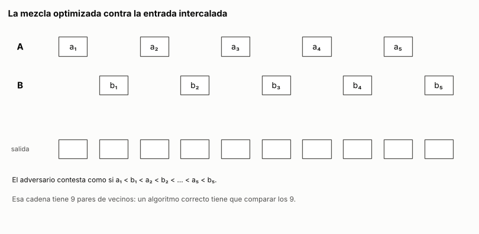

# Ejercicio 9. Una mezcla "optimizada"

> **Enunciado.** ★★ Una mezcla "optimizada" de dos listas ordenadas de largo $n$ deja de comparar cuando a la primera lista le queda un solo elemento, y lo pone al final. Cuenta cuántas comparaciones hace en el peor caso. Sin probarla, usa la sección 6 de la conferencia 5 para decidir si es correcta, y construye con el adversario la entrada en la que falla. (C5)

## Respuesta

- **Peor caso:** $2n - 2$ comparaciones, y ese número se alcanza.
- **No es correcta.** Por C5, §6, todo algoritmo correcto necesita $2n - 1$ comparaciones en el peor caso para mezclar dos listas de largo $n$. Esta hace a lo sumo $2n - 2$ en cualquier entrada, así que tiene que haber entradas donde se equivoca. No hace falta correrla.
- **La entrada:** la intercalada perfecta del adversario, $a_1 < b_1 < a_2 < b_2 < \cdots < a_n < b_n$. Sobre ella la mezcla deja sin comparar el par de vecinos $(a_n, b_n)$ y termina con $\ldots, b_n, a_n$. Con $n = 3$, $A = (1, 3, 5)$ y $B = (2, 4, 6)$ dan $1, 2, 3, 4, 6, 5$.

### El problema y el modelo

Las listas son $A = (a_1, \ldots, a_n)$ y $B = (b_1, \ldots, b_n)$, las dos no decrecientes, con $n \ge 1$. Mezclarlas es devolver sus $2n$ elementos en orden no decreciente.

**Modelo:** comparaciones, como en C5, §1. El algoritmo solo sabe de los valores lo que le contestan las comparaciones $x \le y$ entre dos elementos, y su costo es el número de comparaciones.

### La mezcla optimizada

Es la mezcla de C5, §6 con una condición más para seguir comparando. Mientras a $A$ le queden al menos dos elementos y a $B$ al menos uno, compara el primero que queda de cada lista y saca a la salida el menor (el de $A$ si empatan). Cuando para, puede ser por una de dos razones:

- **$B$ se acabó:** pega lo que queda de $A$, como la mezcla de siempre.
- **A $A$ le queda un solo elemento:** pega lo que queda de $B$ y pone ese elemento al final, sin compararlo.

En Python, con posiciones desde 0 y los elementos accesibles solo a través de `menor_o_igual`:

<!-- codigo: extra_09/mezcla.py mezcla_optimizada -->
```python
def mezcla_optimizada(A, B, menor_o_igual=lambda x, y: x <= y):
    """Mezcla A y B, ordenadas y del mismo largo, pero deja de comparar cuando
    a A le queda un solo elemento y lo pone al final."""
    R, i, j = [], 0, 0
    while i < len(A) - 1 and j < len(B):
        if menor_o_igual(A[i], B[j]):
            R.append(A[i])
            i += 1
        else:
            R.append(B[j])
            j += 1
    return R + B[j:] + A[i:]  # si a A le queda uno, va al final
```
<!-- /codigo -->

### Cuántas comparaciones hace en el peor caso

Sean $i$ y $j$ cuántos elementos de $A$ y de $B$ salieron comparando. Cada comparación saca exactamente uno, así que al terminar el ciclo el número de comparaciones es $i + j$. Antes de cada comparación vale $i \le n - 2$ y $j \le n - 1$, y cada una sube en 1 a uno de los dos. El ciclo termina en uno de dos estados:

- **A $A$ le queda uno:** la última comparación subió $i$ a $n - 1$ y no tocó $j$, así que $j \le n - 1$. Son a lo sumo $(n - 1) + (n - 1)$.
- **$B$ se acabó:** la última comparación subió $j$ a $n$ y no tocó $i$, así que $i \le n - 2$. Son a lo sumo $(n - 2) + n$.

Con $n = 1$ el ciclo ni empieza, porque a $A$ ya le queda un solo elemento. En todos los casos:

$$
C(n) \le 2n - 2. \tag{1}
$$

**La cota (1) se alcanza.** Para $n \ge 2$, tomemos la intercalada perfecta con $a_{n-1}$ y $b_{n-1}$ intercambiados:

$$
a_1 < b_1 < \cdots < a_{n-2} < b_{n-2} < b_{n-1} < a_{n-1} < b_n < a_n .
$$

La mezcla saca $a_1, b_1, \ldots, a_{n-2}, b_{n-2}$ alternando, con una comparación cada uno. Después saca $b_{n-1}$, comparado con $a_{n-1}$, y $a_{n-1}$, comparado con $b_n$. Ahí a $A$ le queda solo $a_n$ y para, con $i = j = n - 1$: son $2n - 2$ comparaciones. Esta entrada en particular termina bien, porque $a_n$ es el mayor, pero la pregunta era solo cuánto compara.

### Es incorrecta: la cota de C5, §6

C5, §6 demuestra que mezclar dos listas ordenadas de largo $n$ requiere $2n - 1$ comparaciones en el peor caso, para cualquier algoritmo correcto del modelo. La mezcla optimizada hace a lo sumo $2n - 2$ en todas las entradas, por (1). Si fuera correcta, sería un algoritmo correcto que nunca llega a $2n - 1$, y eso contradice la cota. Por lo tanto **no es correcta**: existe al menos una entrada en la que devuelve una salida desordenada.

Es el uso de la cota mínima como detector de errores de C5, §8. El veredicto sale de contar, sin correr ninguna prueba.

### La entrada en la que falla: el adversario

La demostración de C5, §6 dice además dónde buscar. El adversario contesta como si la entrada fuera la intercalada perfecta

$$
a_1 < b_1 < a_2 < b_2 < \cdots < a_n < b_n ,
$$

que tiene $2n - 1$ pares de vecinos. Si un algoritmo termina sin comparar uno de esos pares, intercambiar sus dos valores deja las dos listas ordenadas y todas las respuestas iguales, pero cambia la salida correcta. Como el algoritmo da la misma salida en las dos entradas, se equivoca en una.

**Qué compara la mezcla optimizada contra el adversario.** Para $n \ge 2$, compara $a_1$ con $b_1$ y saca $a_1$, compara $a_2$ con $b_1$ y saca $b_1$, y así alterna. Cuando saca $a_{n-1}$, a $A$ le queda solo $a_n$, y para. Comparó los pares $(a_k, b_k)$ para $k = 1, \ldots, n - 1$ y $(b_k, a_{k+1})$ para $k = 1, \ldots, n - 2$: son $2n - 3$ comparaciones. Le faltan dos pares de vecinos, $(b_{n-1}, a_n)$ y $(a_n, b_n)$, y su salida es

$$
a_1, b_1, \ldots, a_{n-1}, b_{n-1}, b_n, a_n .
$$

**El par $(a_n, b_n)$ da la entrada.** Si intercambiamos los valores de $a_n$ y $b_n$, las listas siguen ordenadas, todas las comparaciones que hizo dan lo mismo y la salida es la misma. La salida correcta, en cambio, pasa a tener $b_n$ antes que $a_n$. La salida de la mezcla pone $b_n$ antes que $a_n$, así que acierta en la entrada intercambiada y **se equivoca en la intercalada perfecta**. Esa es la entrada en la que falla. Con $n = 1$ también: no compara nada, devuelve $b_1, a_1$, y falla si $a_1 < b_1$.

Con valores, $a_k = 2k - 1$ y $b_k = 2k$. Para $n = 3$:

$$
A = (1, 3, 5), \quad B = (2, 4, 6) \quad \longrightarrow \quad 1, 2, 3, 4, 6, 5 .
$$

El otro par sin comparar, $(b_{n-1}, a_n)$, da una segunda entrada con el mismo intercambio: con $n = 2$ es $A = (1, 2)$, $B = (3, 4)$, que la mezcla devuelve como $1, 3, 4, 2$.

### Conclusión

La mezcla optimizada hace a lo sumo $2n - 2$ comparaciones, y esa cota se alcanza (1). Es una menos que las $2n - 1$ que C5, §6 exige a todo algoritmo correcto, así que la mezcla tiene que estar mal. El adversario de la misma sección dice dónde: sobre la entrada intercalada nunca compara $a_n$ con $b_n$, que son vecinos, y por eso pone $a_n$ después de $b_n$ en la propia entrada intercalada.

---

## Extras

### 1. La mezcla contra el adversario, animada

<!-- salida: extra_09/figuras.py animacion -->

<!-- /salida -->

*Figura 1. La mezcla optimizada sobre la entrada intercalada con $n = 5$, dibujada como la figura 8 de C5. Cada línea azul es una comparación hecha, y une siempre dos vecinos de la cadena. Después de 7 comparaciones a $A$ le queda solo $a_5$, y la mezcla deja de comparar. Las líneas punteadas naranjas son los dos pares de vecinos que nunca comparó, $(b_4, a_5)$ y $(a_5, b_5)$, y en naranja quedan las dos posiciones de la salida que están fuera de lugar.*

### 2. Cuándo falla exactamente

El adversario encuentra una entrada. Mirando el último paso se ve cuáles son todas: **la mezcla optimizada falla si y solo si $a_n < b_n$**.

- **Si $a_n < b_n$:** $B$ no puede acabarse primero. Para eso $b_n$ tendría que salir comparado con algún $a_i$ con $i \le n - 2$, es decir, $b_n < a_i \le a_n$. Entonces el ciclo termina con $a_n$ solo en $A$ y $b_n$ todavía en $B$, y la salida pone $a_n$ después de $b_n$.
- **Si $a_n \ge b_n$:** si $B$ se acaba primero, el final es el de la mezcla de siempre. Si no, lo que queda de $B$ sale en orden y es menor o igual que $b_n \le a_n$, así que poner $a_n$ al final es correcto.

Con valores distintos, $a_n < b_n$ quiere decir que el mayor de todos está en $B$. Eso pasa en exactamente la mitad de las intercalaciones, por simetría entre las dos listas. Recorriendo todas, con el peor caso medido al lado:

<!-- salida: extra_09/mezcla.py cuando_falla -->
| n | intercalaciones | fallan | fracción | peor caso medido | 2n − 2 |
|---:|---:|---:|---:|---:|---:|
| 1 | 2 | 1 | 0.50 | 0 | 0 |
| 2 | 6 | 3 | 0.50 | 2 | 2 |
| 3 | 20 | 10 | 0.50 | 4 | 4 |
| 4 | 70 | 35 | 0.50 | 6 | 6 |
| 5 | 252 | 126 | 0.50 | 8 | 8 |
| 6 | 924 | 462 | 0.50 | 10 | 10 |
| 7 | 3,432 | 1,716 | 0.50 | 12 | 12 |
| 8 | 12,870 | 6,435 | 0.50 | 14 | 14 |
<!-- /salida -->

El programa comprueba en cada intercalación que la falla coincide con $a_n < b_n$. Falla la mitad de las entradas para todo $n$, y el peor caso medido es exactamente (1).

### Cómo reproducir

El código y la animación de los extras están en `extra_09/`. Desde la carpeta del tema:

```
pip install -r requirements.txt
python -m comun.regenerar ejercicio-09.md   # recalcula la animación, la tabla y el código de este archivo
```
