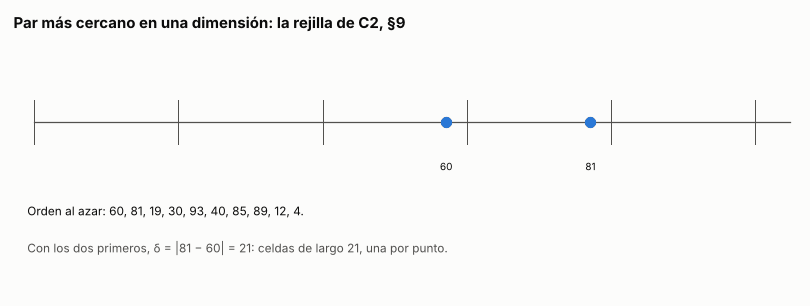

# Ejercicio 10. Par más cercano en una dimensión

> **Enunciado.** ★★ Par más cercano en una dimensión. Demuestra $\Omega(n \log n)$ en árboles de decisión algebraicos por reducción desde distinción de elementos. Después di qué algoritmo de la conferencia 2 rompe la cota, en qué modelo, y adáptalo a una dimensión. (C2, C5)

## Respuesta

- **Cota mínima:** el par más cercano en una dimensión requiere $\Omega(n \log n)$ pruebas en árboles de decisión algebraicos.
  - **La reducción:** una entrada de distinción de elementos ya es una entrada de par más cercano, porque $n$ reales son $n$ puntos en la recta. La distancia mínima es $0$ si y solo si hay dos iguales.
  - **La cuenta:** un árbol para el par más cercano, más una prueba de signo al final, es un árbol para distinción, y por Ben-Or ese árbol tiene profundidad $\Omega(n \log n)$.
  - **Se alcanza:** ordenar y mirar los vecinos la alcanza dentro del modelo.
- **El algoritmo que la rompe:** el incremental aleatorio con rejilla de C2, §9, de costo esperado $O(n)$.
- **El modelo:** una RAM con parte entera y direccionamiento indirecto, es decir, una tabla hash indexada por $\lfloor x/\delta \rfloor$. Con entradas enteras es la word RAM de C1. No lo saca del modelo el azar, sino la parte entera y la tabla.
- **En una dimensión:** las celdas son intervalos de largo $\delta$, cada inserción mira 3 celdas en vez de 25, y el costo esperado sigue siendo $O(n)$.

### El problema y el modelo

**Par más cercano en una dimensión.** Dados reales $x_1, \ldots, x_n$, con $n \ge 2$, devolver un par $i \ne j$ que minimice $|x_i - x_j|$.

**Distinción de elementos.** Dados reales $x_1, \ldots, x_n$, decidir si existen $i \ne j$ con $x_i = x_j$.

**Modelo:** el árbol de decisión algebraico de C2, §8. Cada nodo interno evalúa el signo de un polinomio de grado acotado en $x_1, \ldots, x_n$ y ramifica en tres, según sea negativo, cero o positivo. Cada hoja da una respuesta, y el costo es la profundidad. En este modelo vale el teorema de Ben-Or de C2, §8: distinción de elementos requiere $\Omega(n \log n)$.

### La cota mínima: reducción desde distinción de elementos

Es la reducción de C2, §8, sin la transformación. En el plano había que llevar cada $x_i$ al punto $(x_i, 0)$. En la recta, los $n$ reales de distinción ya son $n$ puntos, así que la entrada se usa tal cual y no hace falta ninguna prueba de signo para construirla.

**Las respuestas se corresponden.** La distancia del par más cercano es $0$ si y solo si dos de los $x_i$ son iguales.

**La composición.** Supongamos que $T$ es un árbol de decisión algebraico de profundidad $d(n)$ que resuelve el par más cercano. Cada hoja $\ell$ de $T$ devuelve un par $(i_\ell, j_\ell)$. Reemplazamos cada hoja por un nodo que prueba el signo de $x_{i_\ell} - x_{j_\ell}$, un polinomio de grado 1. Si es cero, responde "hay dos iguales"; si no, "todos distintos".

El resultado $T'$ es un árbol de decisión algebraico de profundidad $d(n) + 1$, y resuelve distinción. Sobre una entrada cualquiera, $T$ llega a una hoja con un par correcto, es decir, con $|x_i - x_j|$ igual a la distancia mínima.
- **Si hay dos iguales,** la distancia mínima es $0$, la prueba da cero y $T'$ responde bien.
- **Si todos son distintos,** la distancia mínima es positiva, $x_i \ne x_j$, y $T'$ también responde bien.

**La conclusión.** Por el teorema de Ben-Or, $d(n) + 1 = \Omega(n \log n)$, así que

$$
d(n) = \Omega(n \log n). \tag{1}
$$

**La cota se alcanza dentro del modelo.** Se ordena con mergesort. Cada comparación es la prueba de signo de $x_i - x_j$, y son $O(n \log n)$. Si $y_1 \le \cdots \le y_n$ son los valores ordenados, el par más cercano está entre vecinos. Si $l \ge k + 2$, entonces $y_k \le y_{k+1} \le y_l$, así que $y_{k+1} - y_k \le y_l - y_k$. Queda elegir la menor de las $n - 1$ diferencias entre vecinos, con $n - 2$ pruebas de signo de $(y_{k+1} - y_k) - (y_{m+1} - y_m)$, también de grado 1. En total son $O(n \log n)$ pruebas, y en ese modelo el problema cuesta $\Theta(n \log n)$.

### El algoritmo que rompe la cota y su modelo

**El algoritmo** es el incremental aleatorio de C2, §9. Inserta los puntos en orden aleatorio y mantiene $\delta$, la distancia mínima entre los ya insertados, y una rejilla de celdas de lado $\delta/2$ guardada en una tabla hash. Su costo esperado en el plano es $O(n)$, por debajo de la cota (1).

**El modelo.** No hay contradicción, por lo que dice C2, §10. El algoritmo hace dos cosas que un árbol de decisión algebraico no puede hacer:
- **Calcula la parte entera** de una coordenada dividida por $\delta$, para saber en qué celda cae. La parte entera no es un polinomio, ni siquiera es continua, así que no es una prueba de signo.
- **Usa ese resultado como dirección** para ir a buscar la celda a la tabla hash. Un árbol no tiene direccionamiento indirecto: solo ramifica.

Corre entonces en una RAM que además de la aritmética tiene parte entera y direccionamiento indirecto, y bits aleatorios para la permutación y la tabla hash. Con entradas enteras, como en el código de abajo, es la word RAM de C1, donde la parte entera es la división entera. El azar no es lo que rompe la cota: C2, §10 cita que distinción de elementos sigue costando $\Omega(n \log n)$ en árboles algebraicos aleatorizados. El azar solo sirve para que se esperen pocas reconstrucciones.

### La adaptación a una dimensión

En la recta, las celdas son los intervalos $[k\delta, (k+1)\delta)$, y la celda de $x$ es $\lfloor x/\delta \rfloor$. El algoritmo hace lo siguiente:

1. Permuta los puntos al azar: $p_1, \ldots, p_n$.
2. Pone $\delta = |p_2 - p_1|$. Si es $0$, responde ese par. Si no, guarda $p_1$ y $p_2$ en la tabla, cada uno en su celda.
3. Para $i = 3, \ldots, n$, calcula la celda $c = \lfloor p_i/\delta \rfloor$ y mira las celdas $c - 1$, $c$ y $c + 1$.
   - Si encuentra un punto a distancia menor que $\delta$, toma el más cercano y baja $\delta$ a esa distancia. Si quedó en $0$, termina, porque no puede bajar más. Si no, reconstruye la rejilla con $p_1, \ldots, p_i$ y el lado nuevo.
   - Si no, guarda $p_i$ en la celda $c$.

En Python, sobre enteros, con la tabla hash como un `dict` y la división entera `//` como parte entera:

<!-- codigo: extra_10/cercano.py par_cercano_rejilla -->
```python
def par_cercano_rejilla(x, azar=random, traza=None):
    """La rejilla de C2, §9 en una dimensión, sobre enteros: celdas de largo
    delta, la celda de un punto es su parte entera de x / delta, y la rejilla
    es una tabla hash (un dict). Devuelve (distancia, i, j). Si `traza` es una
    lista, anota los pasos para la animación."""
    n = len(x)
    orden = list(range(n))
    azar.shuffle(orden)
    p = [x[k] for k in orden]
    if traza is not None:
        traza.append(p)

    def construir(m, delta): 
        return {p[k] // delta: k for k in range(m)}

    delta, a, b = abs(p[1] - p[0]), 0, 1
    if delta == 0:
        return 0, orden[0], orden[1]
    rejilla = construir(2, delta)
    for i in range(2, n):
        c = p[i] // delta
        cerca = [rejilla[v] for v in (c - 1, c, c + 1) if v in rejilla] 
        mejor = min(cerca, key=lambda k: abs(p[i] - p[k]), default=None)
        if traza is not None:
            traza.append((i, delta, c, mejor))
        if mejor is not None and abs(p[i] - p[mejor]) < delta:
            delta, a, b = abs(p[i] - p[mejor]), mejor, i
            if delta == 0: 
                break
            rejilla = construir(i + 1, delta)
        else:
            rejilla[c] = i
    return delta, orden[a], orden[b]
```
<!-- /codigo -->

**Por qué es correcto.** En todo momento, $\delta$ es la distancia mínima entre los puntos ya insertados, y cada celda guarda a lo sumo uno de ellos. Lo sostienen dos hechos:

- **Un punto por celda:** dos puntos en el mismo intervalo de largo $\delta$ están a menos de $\delta$. En el plano el lado era $\delta/2$, por la diagonal.
- **Bastan tres celdas:** si $|y - p_i| < \delta$, los cocientes $y/\delta$ y $p_i/\delta$ difieren en menos de 1, así que sus partes enteras difieren en a lo sumo 1.

Así, si $p_i$ tiene un punto a menos de $\delta$, ese punto está en las tres celdas que se miran, y el más cercano da la distancia mínima nueva. Si no, $\delta$ no cambia y la celda de $p_i$ está vacía.

**Costo esperado.** Una inserción sin reconstrucción hace tres accesos a la tabla, $O(1)$ esperado, y una reconstrucción en el paso $i$ cuesta $O(i)$. Con el análisis hacia atrás de C2, §9, el paso $i$ reconstruye con probabilidad a lo sumo $2/i$, así que

$$
\mathbb{E}[\text{costo}] = O(n) + \sum_{i=3}^{n} \frac{2}{i} \cdot O(i) = O(n). \tag{2}
$$

### Conclusión

En árboles de decisión algebraicos, el par más cercano en una dimensión cuesta $\Theta(n \log n)$. La cota (1) sale de distinción de elementos sin transformar la entrada, y ordenar la alcanza. La rejilla de C2, §9, llevada a la recta con celdas de largo $\delta$ y tres celdas por consulta, lo resuelve en $O(n)$ esperado (2). No contradice (1), porque usa la parte entera y una tabla hash, que el modelo de la cota no tiene.

---

## Extras

### 1. La rejilla en una dimensión, animada

<!-- salida: extra_10/figuras.py animacion -->

<!-- /salida -->

*Figura 1. La rejilla sobre diez puntos de la recta, insertados en orden aleatorio. Las marcas verticales separan las celdas de largo $\delta$. En cada inserción, el bloque naranja son las tres celdas que se miran, con la del punto nuevo más oscura. Cuando aparece un punto a menos de $\delta$, la línea naranja marca el par nuevo, $\delta$ baja de 21 a 11, a 10 y a 4, y las marcas se redibujan con el lado nuevo. Las otras inserciones cuestan tres accesos a la tabla. En todo momento cada celda tiene a lo sumo un punto.*

### Cómo reproducir

El código y la animación del extra están en `extra_10/`. Desde la carpeta del tema:

```
pip install -r requirements.txt
python -m comun.regenerar ejercicio-10.md   # recalcula la animación y el código de este archivo
```
