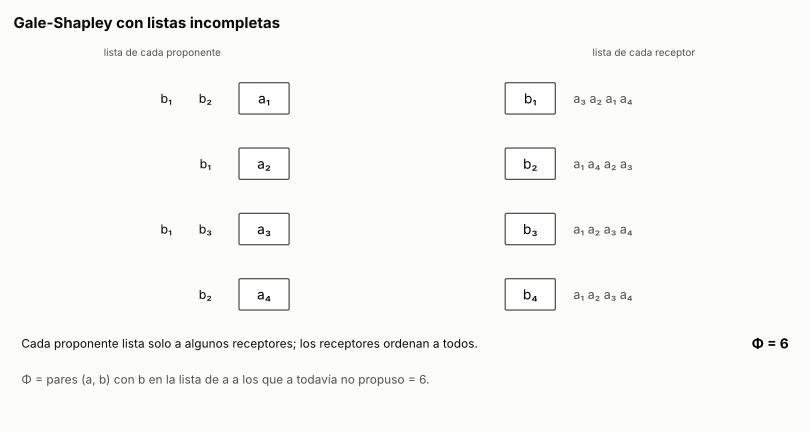

# Ejercicio 12. Gale-Shapley con listas incompletas

> **Enunciado.** ★★★ Gale-Shapley con listas incompletas: cada proponente lista solo a algunos receptores, y prefiere quedarse solo antes que con uno que no listó. Adapta el algoritmo, su potencial y la definición de pareja bloqueante. ¿Sigue siendo estable el resultado? Demuéstralo. (C3)

## Respuesta

- **Pareja bloqueante:** un par $(a, b)$ que no está junto, con $b$ en la lista de $a$, tal que $a$ está solo o prefiere $b$ a su pareja, y $b$ está sola o prefiere $a$ a su pareja. Además, un emparejamiento solo puede juntar a $a$ con receptores de su lista.
- **Algoritmo:** el de C3. La única diferencia es que un proponente libre que ya le propuso a toda su lista deja de actuar y queda solo.
- **Potencial:** $\Phi$ = cantidad de pares $(a, b)$, con $b$ en la lista de $a$, a los que $a$ todavía no les propuso. Empieza en $\sum_a |L(a)| \le n^2$ y baja en 1 con cada propuesta.
- **Sí, sigue siendo estable.** La demostración de C3 sirve con dos casos nuevos. Si $a$ terminó solo, le propuso a toda su lista. Si $b$ recibió alguna propuesta, nunca vuelve a estar sola.

### El problema y el modelo

- **Los proponentes:** cada proponente $a$ tiene una lista $L(a)$ de algunos receptores, en orden estricto de preferencia. Prefiere cualquier receptor de $L(a)$ a quedarse solo, y quedarse solo a cualquier receptor que no está en $L(a)$.
- **Los receptores:** cada receptor $b$ ordena a todos los proponentes y prefiere a cualquiera antes que quedarse solo.

**Emparejamiento:** un conjunto de pares $(a, b)$ en el que cada persona aparece a lo sumo una vez y, en cada par, $b \in L(a)$. Algunos pueden quedar solos. La condición $b \in L(a)$ es la primera adaptación: si $a$ estuviera con un receptor que no listó, preferiría deshacer el par y quedarse solo, así que ese emparejamiento ya sería inestable por culpa de una sola persona.

**Pareja bloqueante:** un par $(a, b)$ que no está junto en el emparejamiento, con $b \in L(a)$, tal que

$$
\text{(i) } a \text{ está solo o prefiere } b \text{ a su pareja,} \qquad \text{(ii) } b \text{ está sola o prefiere } a \text{ a su pareja.} \tag{1}
$$

Respecto de C3 cambian dos cosas. Solo pueden bloquear receptores de la lista de $a$, porque a los demás $a$ no los quiere. Y estar solo cuenta como peor que cualquier opción aceptable, de los dos lados. Un emparejamiento es **estable** si no tiene parejas bloqueantes.

### El algoritmo adaptado

Mientras haya un proponente libre que todavía no le propuso a toda su lista, ese proponente le propone al mejor receptor de su lista al que no le ha propuesto. El receptor actúa como en C3:
- **Si está libre,** acepta.
- **Si tiene pareja y prefiere al nuevo,** lo acepta, y su pareja anterior queda libre.
- **Si no,** lo rechaza.

Un proponente que queda libre después de haberle propuesto a toda su lista no vuelve a actuar, y termina solo. En el código, la cola de libres guarda solo a los libres que todavía tienen a quién proponerle, y un rechazado vuelve a ella solo si le queda lista:

<!-- codigo: extra_12/gale_shapley.py gale_shapley_incompleto -->
```python
def gale_shapley_incompleto(pref_a, pref_b, traza=None):
    n_a, n_b = len(pref_a), len(pref_b)
    rango = [[0] * n_a for _ in range(n_b)]  
    for b in range(n_b):
        for lugar, a in enumerate(pref_b[b]):
            rango[b][a] = lugar
    siguiente = [0] * n_a
    pareja_de_b = [None] * n_b
    libres = deque(a for a in range(n_a) if pref_a[a]) 
    propuestas = 0
    while libres:
        a = libres.popleft()
        b = pref_a[a][siguiente[a]]
        siguiente[a] += 1
        propuestas += 1
        actual = pareja_de_b[b]
        if actual is None:
            pareja_de_b[b] = a
            rechazado = None
        elif rango[b][a] < rango[b][actual]:
            pareja_de_b[b] = a
            rechazado = actual
        else:
            rechazado = a
        if rechazado is not None and siguiente[rechazado] < len(pref_a[rechazado]):
            libres.append(rechazado)  # si agotó su lista, queda solo
        if traza is not None:
            traza.append((a, b, rechazado))
    pareja_de_a = [None] * n_a
    for b, a in enumerate(pareja_de_b):
        if a is not None:
            pareja_de_a[a] = b
    return pareja_de_a, propuestas
```
<!-- /codigo -->

### Terminación: el potencial

Sea

$$
\Phi = \#\{(a, b) : b \in L(a) \text{ y } a \text{ todavía no le propuso a } b\} = \sum_a \bigl(|L(a)| - \text{propuestas hechas por } a\bigr). \tag{2}
$$

Es un entero no negativo, y empieza en $\Phi_0 = \sum_a |L(a)| \le n^2$. Cada vuelta del ciclo es exactamente una propuesta, porque solo actúan proponentes a los que les queda lista. Esa propuesta nunca se repite, porque cada proponente avanza en su lista. Así que cada vuelta baja $\Phi$ en 1, y el algoritmo termina después de a lo sumo $\sum_a |L(a)|$ vueltas.

A diferencia de C3, no hace falta demostrar que nadie se queda sin lista: quedarse sin lista ahora está permitido, y quiere decir quedarse solo. Con los punteros al siguiente de cada lista y la tabla de rangos de C3, cada vuelta cuesta $O(1)$. Armar la tabla cuesta $O(n^2)$, que es el tamaño de las listas de los receptores, así que el algoritmo es lineal en el tamaño de la entrada.

### Correctitud: tres invariantes

- **(I1)** Un receptor que recibió una propuesta queda comprometido desde ese momento, y su pareja solo mejora en su lista. Solo cambia de pareja si llega alguien que prefiere.
- **(I2)** Cada proponente propone en el orden de su lista, y solo a receptores de su lista.
- **(I3)** Un proponente libre que ya no actúa le propuso a toda su lista. Un proponente deja de actuar estando libre solo en dos casos: tiene la lista vacía desde el principio, o fue rechazado después de haber agotado su lista.

**El resultado es un emparejamiento.** Cada receptor guarda a lo sumo un proponente, y un proponente solo propone cuando está libre, así que está con a lo sumo un receptor. Por (I2), cada par $(a, b)$ cumple $b \in L(a)$.

### Estabilidad: sí, el resultado es estable

Sea $M$ el resultado y supongamos que $(a, b)$ cumple (1): $b \in L(a)$, no están juntos, $a$ está solo o prefiere $b$ a su pareja, y $b$ está sola o prefiere $a$ a su pareja.

**$a$ le propuso a $b$.** Hay dos casos. Si $a$ terminó con una pareja $b'$ que le gusta menos que $b$, por (I2) le propuso a $b$ antes que a $b'$. Si $a$ terminó solo, por (I3) le propuso a toda su lista, y $b$ está en ella.

**Entonces $b$ prefiere a su pareja final.** Desde que recibió la propuesta de $a$, por (I1), $b$ está comprometida, así que al final no está sola. Como al final no está con $a$, en algún momento lo rechazó, al recibir la propuesta o más tarde, a cambio de alguien que prefería. Por (I1), su pareja solo mejoró desde entonces, así que $b$ prefiere su pareja final a $a$.

Esto contradice (ii). No hay parejas bloqueantes, y el resultado es estable.

### Conclusión

Con listas incompletas, la pareja bloqueante (1) exige que $b$ esté en la lista de $a$ y trata estar solo como lo peor aceptable. El potencial (2) cuenta las propuestas que faltan dentro de las listas, empieza en $\sum_a |L(a)|$ y baja en 1 por vuelta. El resultado sigue siendo estable.

---

## Extras

### 1. Una ejecución, animada

<!-- salida: extra_12/figuras.py animacion -->

<!-- /salida -->

*Figura 1. Cuatro proponentes con listas incompletas y cuatro receptores con listas completas. En naranja punteado, la propuesta en curso; en azul, los compromisos; en gris, en la lista de cada proponente, los receptores a los que ya les propuso. $b_1$ cambia dos veces de pareja y solo mejora, como dice (I1). $a_2$ y $a_4$ agotan sus listas y quedan solos, y $b_3$ y $b_4$ quedan solas. $\Phi$ baja de 6 a 1 en cinco propuestas, y no queda ningún par bloqueante.*

### Cómo reproducir

El código y la animación del extra están en `extra_12/`. Desde la carpeta del tema:

```
pip install -r requirements.txt
python -m comun.regenerar ejercicio-12.md   # recalcula la animación y el código de este archivo
```
