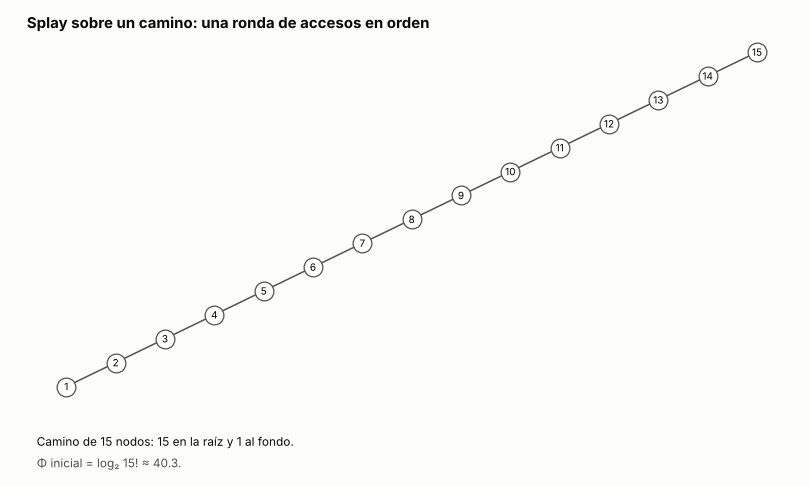

# Ejercicio 13. Splay sobre un camino, accesos en orden

> **Enunciado.** ★★ En un splay tree que empieza como un camino de $n$ nodos se accede a las claves $1, \ldots, n$ en orden. Acota el costo total con el lema de acceso y la cuenta de la sección 5 de la conferencia 4, y compáralo con lo que mide la sección 6. ¿Es ajustada la cota? (C4)

## Respuesta

- **La cota:** por el lema de acceso, cada acceso cuesta amortizado a lo sumo $3 \log_2 n + 1$. Con la cuenta de C4, §5, el total es a lo sumo $n(3 \log_2 n + 1) + \log_2 n! = O(n \log n)$. Aquí el término $\log_2 n!$ sobra, porque la ronda deja otra vez el camino inicial, así que el total es a lo sumo $n(3 \log_2 n + 1)$.
- **Lo que mide C4, §6:** entre 4.2 y 4.4 rotaciones por acceso para $n$ de 100 a 800. La cota permite entre 21 y 30.
- **No es ajustada.** La cota crece como $n \log n$ y lo medido como $n$: sigue en 4.41 por acceso hasta $n = 100\,000$. La cota pierde un factor del orden de $\log n$.

### El problema y el modelo

El árbol inicial es el camino de C4, §4: $n$ en la raíz y cada clave hija izquierda de la siguiente, así que la clave 1 está a profundidad $n - 1$. Una **ronda** es acceder a $1, 2, \ldots, n$ una vez, en ese orden, haciendo splay de cada clave. Como en C4, el costo de un acceso es el número de rotaciones, o 1 si la clave ya está en la raíz.

El potencial es el de C4, §5: $\Phi = \sum_x r(x)$, con $r(x) = \log_2 s(x)$ y $s(x)$ el tamaño del subárbol de $x$.

### La cota: el lema de acceso y la cuenta de C4, §5

**Por acceso.** Por el lema de acceso, el costo amortizado de hacer splay de $x$ es a lo sumo $3(r(t) - r(x)) + 1$, donde $t$ es la raíz. Como $r(t) = \log_2 n$ y $r(x) \ge 0$, cada acceso tiene costo amortizado $a_i \le 3 \log_2 n + 1$.

**El total.** Con costos reales $c_i$ y $a_i = c_i + \Phi_i - \Phi_{i-1}$, sumando sobre los $n$ accesos de la ronda:

$$
\sum_{i=1}^{n} c_i = \sum_{i=1}^{n} a_i + \Phi_0 - \Phi_n \le n(3 \log_2 n + 1) + \Phi_0 - \Phi_n. \tag{1}
$$

La cuenta de C4, §5 termina así: el potencial inicial es el de un camino, $\Phi_0 = \sum_{k=1}^{n} \log_2 k = \log_2 n!$, y $\Phi_n \ge 0$. Entonces

$$
\sum_{i=1}^{n} c_i \le n(3 \log_2 n + 1) + \log_2 n! \le 4n \log_2 n + n = O(n \log n). \tag{2}
$$

**En esta secuencia, $\Phi_n = \Phi_0$.** Después de acceder a $k$, la raíz es $k$ y su subárbol izquierdo es el camino $k - 1, k - 2, \ldots, 1$, cada uno hijo izquierdo del anterior y sin hijo derecho.
- **Para $k = 1$** el subárbol izquierdo es vacío.
- **De $k - 1$ a $k$:** la clave $k$ es la menor del subárbol derecho de la raíz $k - 1$. Todos los pasos del splay salvo el último ocurren dentro de ese subárbol, sin tocar a $k - 1$ ni a su izquierda. El último es un zig, si $k$ es hijo derecho de la raíz, o un zig-zag, si es hijo izquierdo del hijo derecho. En los dos casos $k - 1$ queda como hijo izquierdo de $k$, con su camino a la izquierda y, a la derecha, el subárbol izquierdo que tenía $k$, que está vacío porque $k$ era la menor.
- **Con $k = n$,** que además no tiene nada a su derecha, el árbol es exactamente el camino inicial.

Así que $\Phi_n = \Phi_0$, el término $\Phi_0 - \Phi_n$ de (1) vale 0, y

$$
\sum_{i=1}^{n} c_i \le n(3 \log_2 n + 1). \tag{3}
$$

Además, cada ronda empieza en el mismo árbol, así que todas cuestan lo mismo.

### Lo que mide C4, §6

C4, §6 promedia el costo por acceso sobre tres rondas seguidas y obtiene 4.2, 4.2, 4.3 y 4.4 para $n = 100, 200, 400, 800$. Como las rondas son iguales, ese promedio es el costo de una ronda dividido por $n$. Repitiendo la medición junto a lo que permite el lema:

<!-- salida: extra_13/splay.py comparacion -->
| n | costo de una ronda | por acceso | lema con los rangos reales, por acceso | 3 log₂ n + 1 |
|---:|---:|---:|---:|---:|
| 100 | 416 | 4.2 | 14.4 | 20.9 |
| 200 | 840 | 4.2 | 16.2 | 23.9 |
| 400 | 1,732 | 4.3 | 18.0 | 26.9 |
| 800 | 3,490 | 4.4 | 19.9 | 29.9 |

Con $n$ más grande, una ronda cuesta 4.41 con n = 10,000 y 4.41 con n = 100,000 rotaciones por acceso.
<!-- /salida -->

La columna "por acceso" coincide con la de C4, §6, y el programa comprueba que las tres rondas cuestan lo mismo y que cada una termina en el camino. La columna del lema con los rangos reales suma $3(\log_2 n - r(x)) + 1$ con el rango que tiene $x$ justo antes de su acceso, sin reemplazarlo por 0.

### ¿Es ajustada la cota? No

- **Crecen distinto.** La cota por acceso, $3 \log_2 n + 1$, sube 3 cada vez que $n$ se duplica. Lo medido se queda cerca de 4.4: la cota pasa de 5 veces lo medido en $n = 100$ a casi 7 veces en $n = 800$, y la distancia sigue creciendo como $\log n$.
- **No es solo por usar $r(x) \ge 0$.** Con los rangos reales el lema da entre 14 y 20 por acceso, y también crece con $\log n$.
- **Dónde pierde el lema.** Acota cada acceso por separado, con el peor caso para el rango de $x$. En esta secuencia los accesos caros son los primeros: cuestan $n - 1$, unos $n/2$, unos $n/4$, porque el splay reduce a la mitad la profundidad del camino de acceso, como dice C4, §6. Esos accesos los paga sobre todo la bajada de potencial: el del primero sale negativo (extra 1). Los demás cuestan entre 1 y unas pocas rotaciones, pero el lema les sigue permitiendo hasta $3 \log_2 n + 1$, porque la clave accedida suele tener un subárbol chico.

Lo que sí se sabe con certeza es que el total está entre $2n - 2$ y $n(3 \log_2 n + 1)$. La primera cota sale de que el primer acceso cuesta $n - 1$ y cada uno de los otros al menos 1.

### Conclusión

El lema de acceso y la cuenta de C4, §5 acotan la ronda por $n(3 \log_2 n + 1) + \log_2 n!$ (2). Como la ronda devuelve el camino inicial, el potencial final es igual al inicial y queda $n(3 \log_2 n + 1)$ (3). C4, §6 mide unas 4.2 a 4.4 rotaciones por acceso, contra 21 a 30 que permite la cota. La cota no es ajustada para esta secuencia: es $\Theta(n \log n)$ y el costo medido es lineal. El lema garantiza $O(\log n)$ amortizado para cualquier secuencia, pero no ve que en los accesos en orden la clave buscada casi siempre está cerca de la raíz.

---

## Extras

### 1. Una ronda, animada

<!-- salida: extra_13/figuras.py animacion -->

<!-- /salida -->

*Figura 1. Una ronda sobre el camino de 15 nodos. Cada cuadro es el árbol después de un acceso, con la clave accedida en naranja y las ya accedidas en celeste. Los primeros accesos cuestan 14, 7 y 4 rotaciones, y el primero tiene costo amortizado negativo, porque la bajada de potencial lo paga. Después cada acceso cuesta entre 1 y 4, y su costo amortizado queda muy por debajo de lo que el lema permite para cada uno. A la izquierda de la raíz siempre queda el camino de las claves ya accedidas, y al final el árbol vuelve a ser el camino inicial, como dice el argumento de $\Phi_n = \Phi_0$.*

### Cómo reproducir

El código y la animación del extra están en `extra_13/`. Desde la carpeta del tema:

```
pip install -r requirements.txt
python -m comun.regenerar ejercicio-13.md   # recalcula la tabla, la animación y el código de este archivo
```
