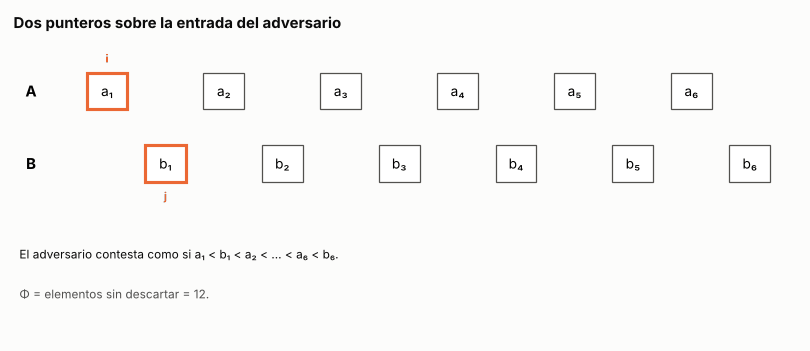

# Ejercicio 14. El ciclo completo: ¿son disjuntos dos arreglos ordenados?

> **Enunciado.** ★★★ Escoge un problema que no hayamos visto, recorre el ciclo completo de la conferencia 2 sobre él y consigue que el algoritmo y la cota mínima coincidan. Es el formato de la pregunta larga del examen final. (C2 a C5)

## Respuesta

- **El problema:** dados dos arreglos estrictamente crecientes de largo $n$, decidir si tienen algún elemento en común.
- **El algoritmo:** dos punteros. Se comparan los primeros que quedan de cada arreglo: si son iguales hay un elemento común, y si no, se descarta el menor. Hace a lo sumo $2n - 1$ comparaciones, y ese número se alcanza.
- **Por qué es correcto:** el invariante dice que ningún elemento descartado está en el otro arreglo. El potencial, la cantidad de elementos sin descartar, baja en 1 por comparación.
- **La cota mínima:** un adversario obliga a todo algoritmo de comparaciones a hacer $2n - 1$ comparaciones. Cada par de vecinos de la entrada intercalada tiene que compararse, porque si no, igualar ese par cambia la respuesta sin cambiar ninguna comparación.
- **Coinciden exactamente:** el problema cuesta $2n - 1$ comparaciones, y los dos punteros son óptimos.


### 1. ¿Qué es el problema?

**Disjuntos.** Dados $A = (a_1 < a_2 < \cdots < a_n)$ y $B = (b_1 < b_2 < \cdots < b_n)$, con $n \ge 1$, decidir si existen $i, j$ con $a_i = b_j$. La respuesta es "disjuntos" o un par $(i, j)$ que lo muestra.

**Modelo:** comparaciones entre un elemento de cada arreglo, con tres respuestas, $<$, $=$ o $>$, como en la búsqueda de C5, §3. El costo es el número de comparaciones.

### 2. ¿Qué algoritmo lo resuelve?

**Dos punteros.** Hay un índice $i$ en $A$ y un índice $j$ en $B$, los dos empiezan en 1. Mientras queden elementos en los dos arreglos, se compara $a_i$ con $b_j$:

1. Si $a_i = b_j$, responde el par $(i, j)$.
2. Si $a_i < b_j$, descarta $a_i$: pasa a $i + 1$.
3. Si $a_i > b_j$, descarta $b_j$: pasa a $j + 1$.

Cuando uno de los dos arreglos se acaba, responde **"disjuntos"**. Es la mezcla de C5, §6 sin escribir la salida y deteniéndose en el primer empate.

En Python, con posiciones desde 0 y los elementos accesibles solo a través de `comparar`:

<!-- codigo: extra_14/disjuntos.py disjuntos -->
```python
def disjuntos(A, B, comparar=lambda x, y: (x > y) - (x < y)):
    """A y B estrictamente crecientes. `comparar(x, y)` devuelve -1, 0 o 1 y es
    la única forma de mirar los elementos. Devuelve None si son disjuntos, o un
    par (i, j) con A[i] == B[j]."""
    i, j = 0, 0
    while i < len(A) and j < len(B):
        r = comparar(A[i], B[j])
        if r == 0:
            return i, j
        if r < 0:
            i += 1  # A[i] es menor que todo lo que queda de B
        else:
            j += 1  # B[j] es menor que todo lo que queda de A
    return None
```
<!-- /codigo -->

### 3. ¿Por qué es correcto?

**Invariante.** Antes de cada comparación,

$$
\text{ningún } a_k \text{ con } k < i \text{ está en } B, \text{ y ningún } b_l \text{ con } l < j \text{ está en } A. \tag{1}
$$

Al principio no hay nada descartado. Si $a_i < b_j$, entonces $a_i$ es menor que $b_j, \ldots, b_n$, y no es ninguno de $b_1, \ldots, b_{j-1}$, que por (1) no están en $A$. Así que $a_i$ no está en $B$ y se puede descartar. El caso $a_i > b_j$ es simétrico, y si $a_i = b_j$ el par es correcto. Si el ciclo termina sin empate, uno de los dos arreglos quedó descartado entero, y por (1) son disjuntos.

**Terminación.** El potencial $\Phi = (n - i + 1) + (n - j + 1)$, la cantidad de elementos sin descartar, empieza en $2n$ y cada comparación sin empate lo baja en 1.

### 4. ¿Cuánto cuesta?

Antes de cada comparación quedan elementos en los dos arreglos, así que $\Phi \ge 2$. Por eso hay a lo sumo

$$
C(n) \le 2n - 1 \tag{2}
$$

comparaciones, y es exactamente lo que cuesta la entrada intercalada $a_1 < b_1 < a_2 < \cdots < a_n < b_n$. El tiempo es $O(n)$ y la memoria extra $O(1)$.

### 5. ¿Se puede hacer mejor?

No. Contar salidas no sirve, porque la respuesta es solo "sí" o "no" (C5, §4), así que la cota sale con un adversario (C5, §5).

El adversario contesta como si la entrada fuera la intercalada $I$, con $a_k = 2k - 1$ y $b_k = 2k$, que es disjunta. Sus $2n - 1$ **pares de vecinos** son los de valores consecutivos $(t, t + 1)$, y cada uno tiene un elemento de cada arreglo.

Si un algoritmo responde sobre $I$ sin haber comparado algún par de vecinos $(t, t + 1)$, sea $I'$ la entrada $I$ con el elemento que vale $t + 1$ cambiado a $t$.
- **Sigue ordenada:** en su arreglo, ese elemento queda entre $t - 1$ y $t + 3$.
- **Las respuestas son las mismas:** todo otro elemento vale $\le t - 1$ o $\ge t + 2$, así que queda del mismo lado de $t$ que de $t + 1$.
- **La respuesta correcta cambia:** en $I'$ hay un valor $t$ en los dos arreglos.

El algoritmo da la misma respuesta en $I$ y en $I'$, así que se equivoca en una. Todo algoritmo correcto compara entonces los $2n - 1$ pares de vecinos:

$$
C(n) \ge 2n - 1. \tag{3}
$$


### Conclusión

Los dos punteros deciden si dos arreglos ordenados de largo $n$ son disjuntos con a lo sumo $2n - 1$ comparaciones (2). El invariante (1) garantiza que nunca descartan un elemento común, y el potencial, que terminan. El adversario de la entrada intercalada obliga a cualquier algoritmo de comparaciones a hacer al menos $2n - 1$ (3). Las dos cotas coinciden exactamente: el problema cuesta $2n - 1$ comparaciones, y el algoritmo es óptimo, incluso en la constante.

---

## Extras

### 1. Los dos punteros contra el adversario, animados

<!-- salida: extra_14/figuras.py animacion -->

<!-- /salida -->

*Figura 1. Los dos punteros sobre la entrada intercalada con $n = 6$, dibujada como la figura 8 de C5. Los recuadros naranjas son los dos elementos que se comparan, y en celeste quedan los descartados. Cada línea azul es una comparación, y une siempre dos vecinos de la cadena. Después de 11 comparaciones, $2n - 1$, $A$ se acaba y la respuesta es "disjuntos". Están los 11 pares de vecinos: si el algoritmo se hubiera saltado uno, el adversario podría igualarlo y la respuesta sería falsa.*

### Cómo reproducir

El código y la animación del extra están en `extra_14/`. Desde la carpeta del tema:

```
pip install -r requirements.txt
python -m comun.regenerar ejercicio-14.md   # recalcula la animación y el código de este archivo
```
